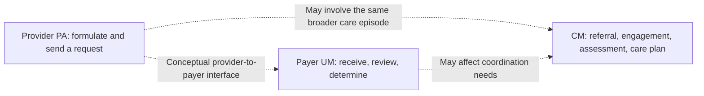
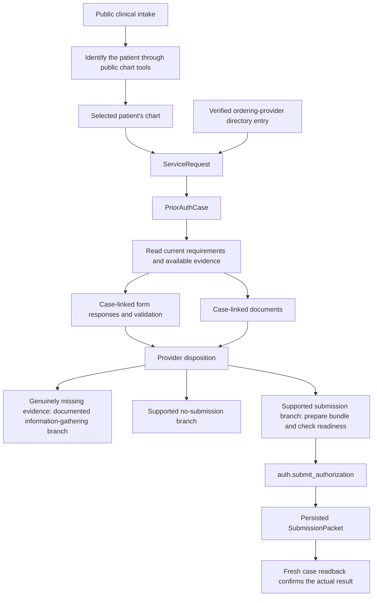
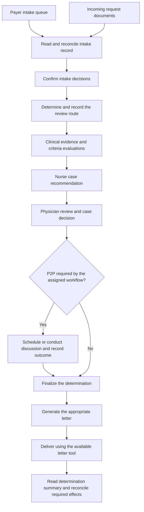
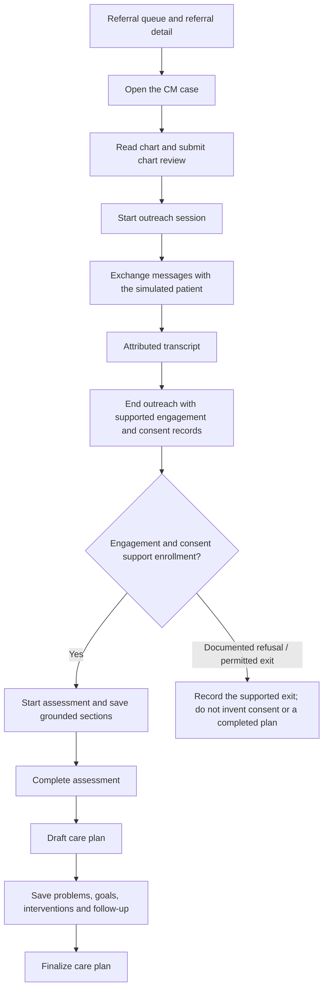
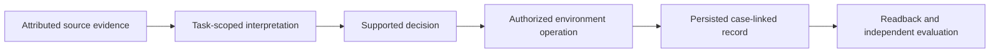

# How three dataset tasks connect their information and actions

See the [glossary](GLOSSARY.md) for healthcare and software terms, especially
[provider actor versus model provider](GLOSSARY.md#1-the-terms-most-easily-confused).

This explains one task from each of the three core domains. It explains the relationships between records and steps, rather than the medical values in a patient's fields. Workflow state names are used where necessary to distinguish preparation from an actual effect.

## 1. What the three domains represent

| Domain | Viewpoint | Main question | Main work product |
| --- | --- | --- | --- |
| PA / `pa_provider` | Requesting provider's authorization operation | What service is being requested, why is it supported, and should/how should the request be sent? | A documented provider disposition and, when appropriate, a submitted authorization packet |
| UM / `pa_um` | Payer's utilization-management operation | Is the received request administratively valid and clinically supported under the applicable review process? | Intake/review records, a determination when assigned, and required correspondence |
| CM / `cm` | Care-management operation | What support does the person need, what have they agreed to, and what coordinated plan follows? | Outreach/consent records, assessment, and a finalized care plan or a supported terminal exit |

PA and UM describe different sides of an authorization workflow. CM describes longitudinal coordination and patient engagement. These are managed-care operational tasks, not a simulation of every department of a hospital.

There are 25 core tasks in each domain, 75 in total. Tasks can begin at different stages. An intake example does not imply every UM task starts at intake, or that every CM patient agrees to enrollment.

The dotted links describe healthcare relationships. **Our normal 75-task runner does not feed one PA task's output into the next UM task, or automatically enroll its patient into a CM task.** Each attempt starts its own supplied benchmark world. Similar filenames do not authorize joining cases or reusing patient IDs.

## 2. Provider PA example: a new referral

Structural example: public task `prior_auth_provider/tasks/pa_t012_t012_o001_p01_new_referral_provider`. The public instruction gives a clinical intake narrative and provider tools. It does not supply an already-created actor case that can simply be completed.

### Records and their connections

| Record | What it represents | Connection that matters | Why the connection exists |
| --- | --- | --- | --- |
| Patient chart | Source clinical history and observations | Referenced by `patient_id` | Grounds the service request in the correct person's record |
| Ordering practitioner | The actual requester | `ServiceRequest.ordering_practitioner_id` | Identifies who is requesting the service; a narrative name is not a substitute for a verified directory record |
| ServiceRequest | The clinical service being requested | Holds the patient link, requester link, procedure/diagnosis information, service type and site | Separates the requested service from the administrative authorization case |
| PriorAuthCase | The authorization workflow container | Links `patient_id` and `service_request_id` | Provides the case identity used for forms, documents, decisions and submission |
| Case-line information | The requested items associated with a case | Resolved through the case and its service request | Allows item-level clinical/coding information to remain associated with the correct request |
| Documents and workspace artifacts | Existing evidence or explicitly authored working material | Associated with the case; document references identify attachable items | A file on disk and a document attached to a request are related but different states |
| Form responses | Structured answers required for preparation | Linked to the case and the required form/questionnaire | Makes required information machine-readable and validatable |
| Provider determination | The provider-side decision about proceeding | Associated with the case and its evidence | Records whether to submit, gather evidence, or not submit; it is not the payer's coverage decision |
| Submission bundle | A prepared collection of evidence | Referenced by its document ID when submitting, where appropriate | Packages evidence; creating the bundle alone does not send it |
| SubmissionPacket | The actual submission record | Has `case_id`, submission channel, payload and attached-document references | Provides evidence that the administrative transmission occurred |

### How the work moves

1. `chart.search_patients` and chart reads establish the patient. The patient ID comes from actor-visible data, not from a task filename.
2. `people.list_ordering_providers` supplies usable requester identities.
3. `cases.create_from_order` creates the case. Despite its name, its `source_order_id` argument is optional: it can create a new ServiceRequest from supported intake fields. An empty existing-order list does not by itself make the task impossible.
4. The created case supplies the real case ID. Subsequent documents, forms, decisions and workspace paths must remain attached to that same case.
5. `cases.get_case`, document tools and form tools establish requirements and support. Missing facts remain missing; the actor must not fill them with invented evidence.
6. `auth.finalize_provider_determination` records the provider's disposition. The decision to proceed and the act of submitting are separate operations.
7. On the submission branch, the actor prepares the bundle, obtains the required current-case read, calls `auth.submit_authorization`, and verifies the result.

`ready_to_submit` is a preparation milestone. `submitted` is evidence of a later operation. A payer approval is later still and is not the provider's authority to invent. An explicitly preparation-only task may legitimately stop earlier; ordinary referral completion must not silently treat readiness as submission.

### What is input and what is output here?

The input is the public intake narrative plus the actor-visible chart, directory, requirements and references. The output is **changed benchmark
records**, supported by artifacts and an action trail. A final prose statement or a local completion flag cannot replace those changes.

The recent t012 repair demonstrated actual submission and a saved packet, and passed all applicable deterministic checks. Its earlier run had already passed the two semantic judge checks but failed status. Those are different attempts; their results must not be combined into one invented full pass.

Sources: [public provider tool registry](../Runner/chi-bench/src/chi_bench/mcp/catalog.py),
[case service](../Runner/chi-bench/src/chi_bench/services/cases.py),
[authorization service](../Runner/chi-bench/src/chi_bench/services/auth.py), and
[PA record models](../Runner/chi-bench/src/chi_bench/core/models.py).

## 3. Payer UM example: intake through final determination

Structural example: public task `prior_auth_um/tasks/pa_t011_t011_o003_p01_intake_payer`.
This instruction assigns an end-to-end payer workflow: intake checklist, routing, clinical review, physician decision, any required P2P, and final determination. Other UM tasks may start in triage, nurse review, physician review or a P2P session instead.

### Records and their connections

| Record | Depends on | Supplies to the next step |
| --- | --- | --- |
| Intake queue entry | Received request and its actor-visible identity | The intake/case identifiers used to open the correct work item |
| Intake record | Request header, diagnoses, requesting provider, line items and received documents | A reconciled administrative representation of the request |
| Intake confirmation | The completed checklist and its decisions | Evidence that intake was actually completed, rather than merely inspected |
| Triage/route record | Intake context and applicable routing/timeliness information | The review lane and workflow ownership |
| Nurse criteria evaluations | Clinical evidence and applicable criteria | Item-level findings supporting a recommendation |
| Nurse case recommendation | The collected criteria findings | A case-level recommendation such as escalation or an evidence-supported next step |
| Physician review and decision | Review material, recommendation and additional clinical reasoning | The physician-level case decision; still distinct from finalization |
| P2P request/session/outcome, when required | A reason to seek peer discussion and the relevant case | Additional attributed discussion and a recorded outcome, not an automatic approval |
| Final determination | The completed applicable review/decision workflow | The committed payer decision and associated case state |
| Letter and delivery record | The determination or information-request purpose | Correspondence content and separate evidence of delivery |
| Determination summary | The case's resulting records | A readback used to verify what actually happened |

This is the dependency structure for the selected example, not an unconditional list of operations for every UM task. Applicable automatic routes, administrative failures, requests for information and stage-specific instructions can change the path. A route is a handoff into review, not a clinical approval.

### Why the intermediate records are separate

- An intake record answers whether the received request has been represented properly. It does not answer whether the treatment meets clinical criteria.
- A route chooses where review occurs. Waiting for the final clinical conclusion before selecting a permitted review lane can deadlock the workflow.
- Criteria findings and a nurse recommendation preserve how evidence supports the proposed next step. A physician decision is a separate record, not a renamed nurse recommendation.
- A finalization operation commits the determination. A saved physician note does not necessarily perform that transition.
- A generated letter is not a delivery receipt. Only an actual delivery operation/readback supports a delivery claim. If an expected communication
  operation is unavailable, that capability gap must be stated, not fabricated.

In real organizations these duties may belong to different people. The benchmark's public instruction for this example explicitly assigns the workflow
to one payer actor. Our combined owner may therefore carry out those functions through the supplied payer tools. That does not mean it has unrestricted access to the provider's tools or can create an independent counterparty's evidence.

Sources: [payer tool catalog](../Runner/chi-bench/src/chi_bench/mcp/catalog.py),
[review service](../Runner/chi-bench/src/chi_bench/services/review.py),
[routing guard](../HealthHarnessCodex/health_harness_codex/workflow_guard.py), and
[UM completion mapping](../HealthHarnessCodex/health_harness_codex/completion_contracts.py).

## 4. CM example: referral to finalized care plan

Structural example: public task `care_management/tasks/cm_afib_moderate_anxious_001`.
The instruction assigns intake, outreach, assessment and a finalized care plan. It explicitly requires structured information to be grounded in the chart or outreach transcript, and consent to be recorded only after the script is actually performed in that transcript.

### Records and their connections

| Record | Connection | Why it matters |
| --- | --- | --- |
| CMReferral | Links the referring source, patient and CM case | Identifies why care management was requested; it is not consent to enrollment |
| CMCase | Provides the common case/patient link and program state | Associates all later CM work with the same episode |
| Chart data and submitted chart review | Case-linked source information and a recorded review | Separates reading history from documenting that the review happened |
| Outreach session and transcript | Attached to the case and the conversation | Supplies what the patient actually said and what the care manager actually asked |
| End-of-outreach record | References the completed interaction and records engagement/consent | Connects the conversation to the workflow's next permitted stage |
| CMAssessment | Has an assessment ID and the common case ID | Organizes clinical, medication, behavioral-health and social-needs findings |
| Care-plan problems and goals | Derived from the assessment and attributed sources | Makes the plan respond to observed needs instead of becoming generic advice |
| Interventions, escalation conditions and follow-up | Belong to the care plan and its problems | Describes what should happen, who follows up where represented, and when reassessment/escalation is needed |
| Finalized CMCarePlan | Links back to the case, with committed plan state | Distinguishes an actual finished plan from a draft or a final chat message |

An outreach answer may introduce information that is absent from the chart. That information should retain transcript provenance. A reported medication concern, for example, is evidence of what was reported, not proof that the actor has changed a prescription or arranged a service.

The patient simulator is a counterparty, not the care-manager actor talking to itself. The care manager controls questions and authorized documentation; the simulator supplies the patient's responses. The actor must not write the patient's response directly into the transcript to obtain consent.

Some CM scenarios have a refusal/exit path. Our local completion mapping supports a documented refusal plus committed disenrollment. That is not a universal guarantee of a passing competition outcome, and it is not equivalent to completing a care plan for an enrolled patient.

Sources: [CM tool server](../Runner/chi-bench/src/chi_bench/mcp/cm_server.py),
[CM record models](../Runner/chi-bench/src/chi_bench/core/cm_models.py),
[assessment service](../Runner/chi-bench/src/chi_bench/services/cm_assessment.py), and
[care-plan service](../Runner/chi-bench/src/chi_bench/services/cm_care_plan.py).

## 5. The relationship shared by all three domains

Every arrow carries a different responsibility. A tool result may establish a fact about a record. The model reasons about what that fact means. A permitted tool operation creates an effect. Readback checks that the effect exists. The independent verifier/judge then assesses the task result. None of those steps can be replaced by confidently saying that the task is finished.

The following [implementation guide](02_IMPLEMENTED_HARNESS.md) explains which parts of this chain our code performs and which are delegated to model calls.
