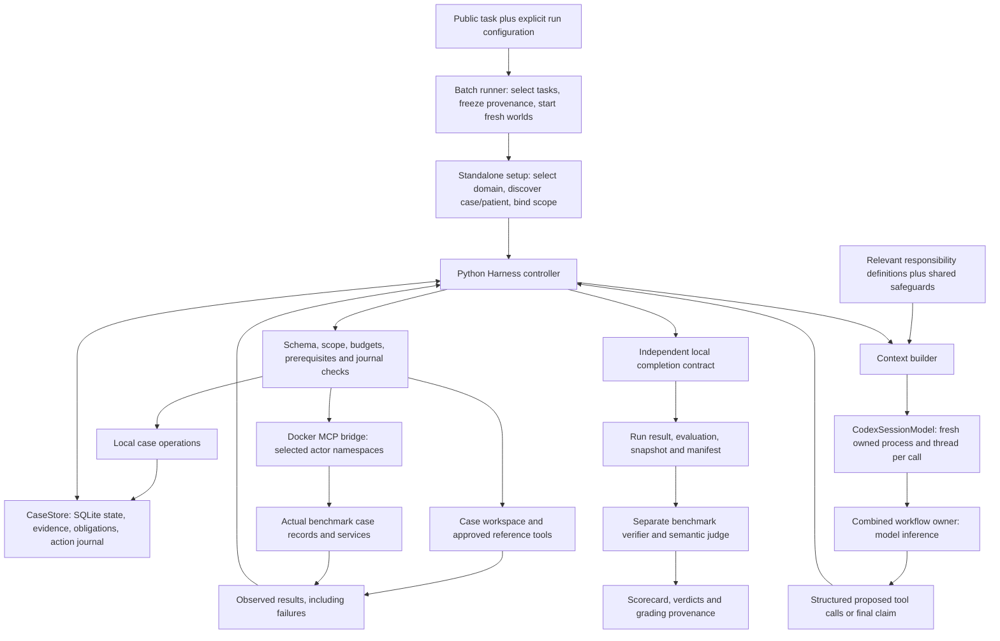
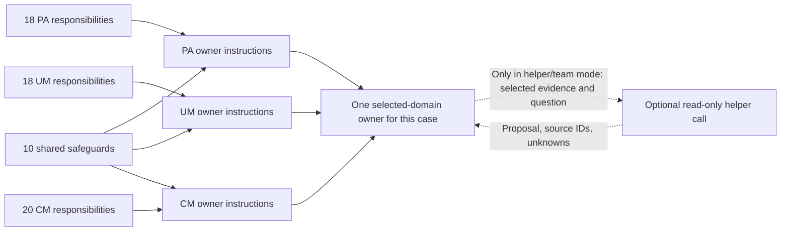
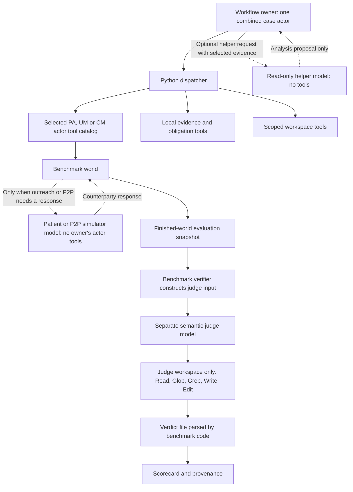
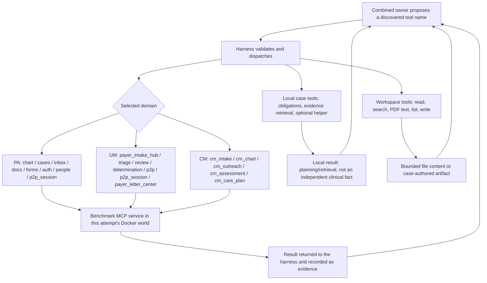
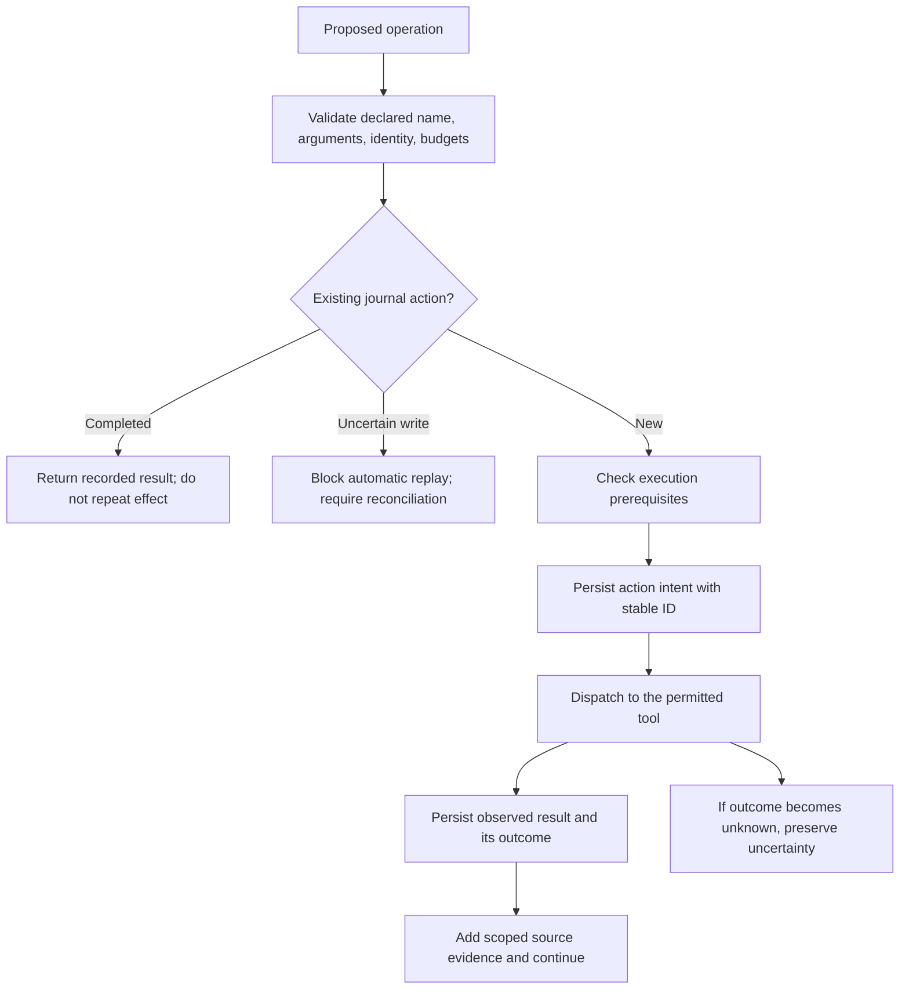

# How the implemented harness works

Keep the [glossary](GLOSSARY.md) open for actor, role, case owner, tools,
scope, memory, context and evaluation terminology.

This describes `HealthHarnessCodex/`, the fork used for the recent real runs. `HealthHarness/` is the preserved original. Research and blueprint documents describe broader possibilities; they are not proof those features are deployed. The original walkthrough used `9fd27cd`; working-context changes were subsequently revised to retain full role instructions and already-read evidence, and to repair permitted tool discovery. Their measured evidence and limits are in [the efficiency implementation report](../Progress/CONTEXT_EFFICIENCY_IMPLEMENTATION.md).

## 1. The actual shape of the system

The normal runner uses one **combined case owner** to reason about a task. Python code owns execution, state, permissions, budgets and completion checks. The owner proposes operations; it cannot directly operate the benchmark through its own Codex shell or tools. Our dispatcher executes the allowed proposals and returns the observations for the next model call.



The separation is deliberate: the model decides what to propose; the controller decides whether/how the proposal may execute; the benchmark performs the effect; the evaluator assesses the outcome. A successful model response proves none of the later steps by itself.

## 2. Which agents actually exist?

| Participant | Implemented form | What it receives | What it can do | What it cannot establish alone |
| --- | --- | --- | --- | --- |
| Workflow owner | Repeated model calls through `CodexSessionModel`; one logical owner per case | Current scoped task context and available tool schemas | Propose operations, interpret observations, maintain obligations, request completion | That a proposed operation happened, or that a benchmark passed |
| Responsibility roles | 66 general definitions in `data/micro_roles.json` | Included as domain-relevant instructions, not independent conversations | Structure the owner's responsibilities | Separate worker execution or competence merely because a role has a name |
| Optional analysis helper | A separate tool-free model call invoked through `case.request_helper` in helper/team modes | One role definition, a question, explicitly selected successful same-case observations | Return a bounded proposal with sources, unknowns and limits | Execute tools, mutate the case, or turn its inference into independent evidence |
| Patient / P2P counterparty simulator | Benchmark-side conversation participant; optionally served by our experimental Codex bridge | A benchmark-generated conversation request | Supply the other participant's response | Make the workflow owner's decisions or grade the owner |
| Semantic judge | In the recent evaluation, Opus 4.7 through the OpenRouter adapter | A separately constructed evaluator workspace and benchmark prompt | Read judge material and write rubric verdicts | Execute actor MCP operations or retroactively fix the clinical task |
| Batch runner, controller, routing guard, completion checker | Ordinary Python code | Configuration, state, proposals and observations | Deterministic orchestration/checks | They are not additional model agents |

The normal batch route uses `composition="combined"`. Its case owner performs the relevant responsibility functions itself. A batch with concurrency three means three independent task attempts, not three hospital specialists working on one patient's case.

There are 18 PA, 18 UM, 20 CM and 10 shared responsibility definitions. A PA owner gets the PA plus shared contracts; UM and CM receive their own domain plus shared contracts. Full role instructions were retained after an overly aggressive compaction experiment. `case.get_role` remains available for explicit lookup. This is not all 66 definitions running independently on every turn. See the [complete catalog](03_ROLE_AND_TOOL_REFERENCE.md).



In helper mode, the owner may request one helper analysis at a time. In team mode, it may select several responsibility analyses, but this implementation executes them sequentially through the configured model. It does not launch a persistent, independently communicating hospital staff team. The owner retains the action authority and must explicitly use or reject helper output.

Sources: [`roles.py`](../HealthHarnessCodex/health_harness_codex/roles.py), [`engine.py`, `_LOCAL_SPECS` and `case.request_helper` handling](../HealthHarnessCodex/health_harness_codex/engine.py), [`standalone.py`, `run_case`](../HealthHarnessCodex/health_harness_codex/standalone.py).

### All model participants and their tool authority in one graph



Only the owner can propose the actor's operations, and only the dispatcher executes them. Helpers, counterparties and the judge do not acquire that authority through their connection to the owner or environment.

## 3. What connects the actor to its tools?



The domain profile selects an actor port and namespaces: provider 8020, payer 8100, care manager 8200. These are separate actor surfaces. The dispatcher does not make all tools on all ports available to every task.

Tool names and JSON schemas come from discovery. The adapter can expose an alias for a discovered tool name; a mapping connects it back to the actual MCP name. The owner may only return a name present in its supplied tool list. Argument validation then checks types, required fields and constrained identity fields. The benchmark still enforces its own service rules.

Workspace operations are a separate set. They use explicit case roots and approved reference paths. Read access to a reference file does not grant its whole parent directory. Case-relative shared-document paths are resolved only within already-approved directories of the bound case. PDF reading currently extracts a text layer with `pypdf`; it does not run DeepSeek OCR.

Sources: [`domain_profiles.py`](../HealthHarnessCodex/health_harness_codex/domain_profiles.py),
[`docker_bridge.py`](../HealthHarnessCodex/health_harness_codex/docker_bridge.py),
[`tools.py`](../HealthHarnessCodex/health_harness_codex/tools.py),
[`schema.py`](../HealthHarnessCodex/health_harness_codex/schema.py).

## 4. How one task becomes model input

### Step A: freeze the run, not a predicted answer

`batch.py` reads public task instructions from the selected dataset domains. It records configuration and provenance, including instruction hashes, source identity, runtime identity and model settings, in `batch.manifest.json`. It starts a fresh world for each attempt and waits for runtime/tool readiness.

Why: two attempts are not comparable if they silently use different tasks, code, environments or model settings. The manifest records what actually ran; it does not contain permission to read hidden expected answers as actor input.

### Step B: select the correct actor and identify its case

`domain_profiles.py` determines the domain from the dataset directory boundary. `standalone.py` performs public actor discovery and records selection provenance. Provider tasks may initially have an observed patient but no real actor case. UM and CM tasks can start from an already-visible intake/referral case.

Provider discovery inspects a bounded public roster. An explicit full-name match can identify the patient directly. Otherwise known demographic contradictions are screened out, retaining unknowns and date ambiguity, and the remaining candidates are compared separately against the clinical narrative. Diagnosis labels and longest shared phrases cannot establish identity. Positive matches require multiple exact source-backed facts; exactly one candidate must qualify before work begins. A preflight capacity check reserves workflow budget, and bootstrap model calls count against the original aggregate cap. No hidden target ID is supplied. The selected patient's observations form the working case context.

Why: operations must target the right case. Guessing an ID from a filename can create internally consistent work on the wrong patient.

### Step C: construct the scope and bind actual identities

`Scope` contains environment, task, organization, principal, patient and case namespaces. A canonical encoding produces the stable scope key used in SQLite. An internal case-subject namespace is a bookkeeping label, not an actor case ID.

If a provider creates a case later, trusted creation output establishes a binding to the actual case. The scope's durable bookkeeping identity and that actual actor ID remain distinguishable. Workspace binding is updated to the observed actual case, and subsequent operations use that bound identity.

Why: a newly created case cannot have been known before creation, but this must not force the harness to guess it or abandon the existing isolated ledger.

### Step D: build the task contract and case context

The harness creates a completion contract from the public task wording and its documented role workflow. The model cannot replace that contract with one it finds easier to satisfy. The model input combines:

| Input component | Origin | Purpose |
| --- | --- | --- |
| Public task | The selected task's `instruction.md` | Defines the assigned work |
| Domain instructions and responsibilities | Our versioned code/catalog | Defines the owner's scope and operational boundaries |
| Scope and verified bindings | Bootstrap and trusted observations | Keeps operations attached to the right task and subject |
| Completion milestones | Harness-owned compiler | A concise view guides the model; the full pinned contract independently enforces observable requirements |
| Tool descriptions and argument schemas | Discovered tools plus local definitions | Defines which operations can be proposed and how |
| Conversation and source observations | CaseStore | Supplies what has already happened and what was returned |
| Obligations and deferred work | Case-local ledger | Keeps unresolved work visible across calls |
| Budget state and recovery feedback | Harness controller | Bounds execution and explains rejected proposals |

Hidden fixtures, expected answers and the judge's private workspace are not part of the actor input. The approved handbook is a reference accessed through its allowed path, not copied into the shareable guide or treated as learned patient-specific memory.

Sources: [`batch.py`](../HealthHarnessCodex/health_harness_codex/batch.py), [`standalone.py`](../HealthHarnessCodex/health_harness_codex/standalone.py), [`identity.py`](../HealthHarnessCodex/health_harness_codex/identity.py), [`completion_contracts.py`](../HealthHarnessCodex/health_harness_codex/completion_contracts.py).

## 5. Where Codex is connected and how its output is used

The actor model connection is centralized in `CodexSessionModel`. Normal owner calls and optional helper calls use the configured model interface. The simulator and judge are distinct integrations because they have separate benchmark interfaces and roles.

For each actor inference the adapter serializes messages, tool specifications and the requested output bound. It starts an owned Codex App Server process in a temporary working directory, performs configuration/instruction-source preflight, creates an ephemeral thread, and requests schema-shaped output. It uses the existing supported sign-in; it does not attach to this desktop conversation or extract/copy credential files.

Known built-in execution capabilities are disabled/rejected by this adapter. The native model returns proposals as data. It is not allowed to use a separate shell, browser, plugin or hidden MCP connection to bypass our dispatcher.

The outer response has this shape; placeholders below are structural labels, not real clinical values:

```json
{
  "content": "",
  "tool_calls": [
    {
      "id": "<call-id>",
      "name": "<discovered-tool-alias>",
      "arguments_json": "{\"case_id\":\"<observed-actual-case-id>\"}"
    }
  ]
}
```

The adapter validates the envelope, unique call IDs, declared names and the arguments JSON. It converts the result into a `ModelReply` with `ToolCall` objects. The engine subsequently validates each call against its actual tool schema and scope.

If no operation is proposed, `tool_calls` is empty. A completion claim belongs inside the `content` string as a structured final object with `status`, `claim` and source `evidence_ids`. That claim is an input to the completion checker, not a command to mark the task successful.

The `max_output_tokens` value is supplied to the native request context; the App Server does not expose it as an equivalent hard API token cap. Local bounds must not be described as exact native-provider dollar/token guarantees.

Sources: [`codex_provider.py`](../HealthHarnessCodex/health_harness_codex/codex_provider.py), [`codex_transport.py`](../HealthHarnessCodex/health_harness_codex/codex_transport.py), [`models.py`](../HealthHarnessCodex/health_harness_codex/models.py).

## 6. How proposals become actual effects

Policy-dependent writes in the live runner also require a source-backed
`case.record_policy_decision`. The model cites retrieved policy passages and
case evidence, explains applicability and unresolved questions, and chooses
the action. A citation identifies an original source ID and text field, with
optional character ranges; code captures exact text. Omitting ranges cites the
entire returned field, not an unread file tail. The worker need not copy text
verbatim. Captured text stays in the audit, not repeated in working context. Code checks actual text/scope and bound action consistency before
dispatch; it does not choose the clinical outcome. An unchanged assessment can
support several declared operations. See [implementation and limitations](../Progress/POLICY_GROUNDING_REPAIR.md).

This graph focuses on journaled external-tool operations. Local ledger/evidence operations are handled directly in the controller rather than being independent remote clinical effects.



There are two related records in SQLite. `cases` stores the versioned working state. `actions` stores operation identity, arguments, effect classification, status and recorded result. Transactions, leases and fencing tokens protect against stale local workers writing over newer state.

An operation that reached a remote service before the local process failed may have happened even if its result was not saved. The harness therefore does not promise exactly-once external effects. It blocks uncertain-write replay instead of turning a timeout into an automatic second submission.

Provider decision/submission guards require a current same-case requirements read. Missing prerequisites can return known-not-dispatched feedback, allowing the model to obtain the read and propose the action normally. UM also has a specific `PayerRoutingGuard` for routing/triage order and supported observed SLA/eligibility data. These are targeted mechanical guards, not a general engine that proves all healthcare reasoning correct.

Returned application errors remain failures even when the network/dispatcher returned normally. The error, source ID and relevant feedback are available to the next model call. A successful empty list is different from an error and must be interpreted in the tool's actual workflow context.

Sources: [`engine.py`](../HealthHarnessCodex/health_harness_codex/engine.py), [`store.py`](../HealthHarnessCodex/health_harness_codex/store.py), [`workflow_guard.py`](../HealthHarnessCodex/health_harness_codex/workflow_guard.py), [`evaluation.py`](../HealthHarnessCodex/health_harness_codex/evaluation.py).

## 7. What memory and context currently mean

The model can request identity reconsideration through
`case.request_identity_reselection`. Before external effects, the controller
quarantines the old working state and starts fresh discovery/context with only
the original task, general instructions and remaining budget. Old patient facts,
drafts, obligations and citations are excluded. External or uncertain writes
block automatic reset and require reconciliation; context reset cannot undo
them. See [the implemented lifecycle](../Progress/IDENTITY_CONTEXT_RESET.md).

The durable case memory is SQLite. It contains messages, complete returned observations, source IDs, obligations, bindings, budget usage and the action journal. A bounded file excerpt is still only that returned excerpt: storing it does not imply the unseen remainder of the source file has been read.

For clinical tasks, `context.py` now delegates to `working_set.py`. It preserves the task and full responsibility/safety instructions, presents source-linked observations and concise completion milestones, and retains bounded recent complete turns plus a cache of already-inspected source fields. Historical readouts are not new evidence or fresh-readback proof. Large fields have explicit retrieval pointers. Equivalent MCP representations are normalized for presentation; full evidence remains unchanged in SQLite. Nonclinical/custom contracts retain the legacy budgeted-transcript projection.

`case.inspect_evidence` reads typed business fields using JSON pointers, with explicit raw representation access for additional MCP content. Original character-offset search/read remains available. `case.find_evidence` locates older source IDs. Tool presentation follows the current stage; the owner can activate other already-permitted tools through `case.discover_tools`. This does not grant additional environment permissions or alter completion rules.

General responsibility definitions persist across cases as versioned code. Patient observations, obligations, decisions and helper discussions are case-scoped. They are not a shared learning store for later patients. The implementation does not prove provider-side deletion, nor does namespace checking protect against arbitrary malicious code with host filesystem access.

The [measured context-bloat audit](04_CONTEXT_BLOAT_ANALYSIS.md) describes the pre-optimization behavior. The implementation now reduces replay and records serialized payload size and native usage passes. The first same-evidence offline projection measured a 62.47% character reduction, but that candidate regressed during execution and was revised. Current live token/quality evidence must be read separately in the [implementation report](../Progress/CONTEXT_EFFICIENCY_IMPLEMENTATION.md). A character reduction is not automatically an equal token or cost reduction.

Sources: [`context.py`](../HealthHarnessCodex/health_harness_codex/context.py), [`store.py`](../HealthHarnessCodex/health_harness_codex/store.py), [`engine.py`, evidence operations](../HealthHarnessCodex/health_harness_codex/engine.py).

## 8. How the loop decides to continue or stop

| Situation | Current behavior | Reason |
| --- | --- | --- |
| Valid proposed operation | Execute after checks and journal handling | A model proposal needs an actual effect to advance work |
| Known schema/prerequisite problem before dispatch | Provide bounded correction feedback | Correcting an unexecuted proposal differs from replaying an uncertain effect |
| Structured early stop or unmet completion milestones | May request up to four targeted recovery rounds within the original budget, with source pointers, observed gaps and failed operations | Recovery must investigate the actual missing dependency rather than repeat a generic blocker |
| Repeated stop without new information | Stop recovery rather than loop indefinitely | Distinct source-field retrieval counts as access progress; duplicate inspections and local notes do not establish new clinical facts |
| Unknown write outcome | Preserve/block for reconciliation | A retry could duplicate an effect |
| Exhausted configured budget | Stop and record the limit | The prototype does not have unlimited search or reasoning |
| Complete claim with missing proof/open work | Reject local completion | The model's confidence cannot waive a required effect |

The local contract checks successful same-scope observations, case identity, required milestones, ordering and fresh readbacks. Ordinary provider referrals cannot complete merely at `ready_to_submit`; explicitly preparation-only tasks can. UM mappings follow the assigned stage and its public endpoint. CM mappings distinguish a finalized plan from supported refusal/disenrollment.

An obligation can be closed only with recorded evidence and completed dependencies. A verified external-document handoff can defer appropriate work without falsely closing it. Deferral sends no notification and does not prove a missing service was delivered. The final result preserves deferred work.

These contracts are code interpretations of the task, not an oracle. The t012 failure demonstrated that an incorrect contract can accept an intermediate state. The independent evaluator remains necessary to assess task correctness.

Sources: [`workflow.py`](../HealthHarnessCodex/health_harness_codex/workflow.py),
[`completion_contracts.py`](../HealthHarnessCodex/health_harness_codex/completion_contracts.py),
[`engine.py`, `_accept_final`](../HealthHarnessCodex/health_harness_codex/engine.py).

## 9. Simulator and judge connections are separate from the owner

```mermaid
flowchart LR
    Owner["Workflow owner"] --> CMTool["CM outreach or P2P tool"]
    CMTool --> Simulation["Benchmark conversation service"]
    Simulation -. "With experimental Codex simulator enabled" .-> Bridge["Container loopback Messages bridge"]
    Bridge --> Spool["Private per-world request/response spool"]
    Spool --> Worker["Host simulator worker"]
    Worker --> Model["Separate Codex model call as patient or P2P counterparty"]
    Model --> Spool
    Spool --> Bridge
    Bridge --> Simulation
    Simulation --> CMTool
    CMTool --> Owner
```



The simulator worker has its own per-world call, character, timeout and deadline limits. The owner cannot use its local helper mechanism as a substitute for a patient response. Simulator conversations are benchmark inputs to the actor, not a second case owner collaborating with it. The recent t012 checks made no counterparty simulator calls, so those runs do not validate that path.

After execution, the batch runner saves the final environment export and filesystem artifacts with integrity hashes, then stops the world. This is an **evaluation packet**, distinct from the **clinical authorization packet** created inside the workflow. An unsuccessful clinical attempt can still produce a valid evaluation packet.

The judge runs later on a disposable copy. The deferred grader substitutes the recorded export for the verifier's live export fetch, preserves the original, and invokes the benchmark verifier. Only the evaluator consumes scoring fixtures; their contents are not sent back into the actor's context.

In the OpenRouter route, the benchmark's WorkspaceJudge builds its workspace, prompt and verdict structure. `OpenRouterJudgeRunner` changes the model transport and provides confined `Read`, `Glob`, `Grep`, `Write` and `Edit` operations. Opus supplies rubric judgments. The benchmark parser and deterministic checks construct the scorecard. Competition acceptance of this alternate transport is not established; the result is explicitly recorded as an evaluator score rather than silently relabeled direct-official grading.

The normal CLI now supports a verified non-resetting server-key spending cap. It does not increase a key's limit. An unknown paid request is not automatically resent. Today's completed evaluation used $0.44215 total, including its initial interrupted requests and explicit continuation.

The synchronous runner now returns after a complete typed verdict file is written, leaving final parsing to benchmark code. It no longer requires a paid acknowledgment turn after the useful output is already saved. Partial verdicts do not trigger this stop. See the [separate judge analysis](05_JUDGE_CONTEXT_ANALYSIS.md).

Sources: [`simulator_bridge.py`](../HealthHarnessCodex/health_harness_codex/simulator_bridge.py), [`simulator_worker.py`](../HealthHarnessCodex/health_harness_codex/simulator_worker.py), [`deferred_grading.py`](../HealthHarnessCodex/health_harness_codex/deferred_grading.py), [`openrouter_judge.py`](../HealthHarnessCodex/health_harness_codex/openrouter_judge.py), [benchmark WorkspaceJudge](../Runner/chi-bench/src/chi_bench/verifier/judge/workspace_judge.py).

## 10. What gets written as output

| Output | Producer | What it establishes | What it does not establish |
| --- | --- | --- | --- |
| Benchmark case records and clinical artifacts | Supplied actor tools | Actual workflow mutations returned by the environment | Automatic correctness of the actor's reasoning |
| `state.sqlite` | CaseStore/controller | Durable case state, observations and operation journal | An independent benchmark verdict |
| `events.jsonl` and live/terminal logs | Evaluation recorder | Stages, waits, model/tool activity and errors | A successful effect merely because dispatch returned |
| `run.result.json` | Standalone runner | Local outcome, completion proof, counters and bindings | An official score |
| `evaluation.json` | Evaluation recorder | Local metrics, errors and observed workflow readback | Full semantic correctness when the judge has not run |
| `batch.manifest.json` | Batch runner | Selected tasks/attempts, frozen provenance and saved/remaining states | That every settled attempt passed |
| Deferred snapshot and hash inventory | Batch runner | Preserved final environment/artifact inputs for later evaluation | A passing clinical result |
| Judge verdicts, reward, scorecard and grading receipt | Separate evaluator | Measured checks and their grading provenance | Reliability across cases that were not evaluated |

The audit trail records observations, proposals, effects, source IDs and stated rationales. It is not access to the model's private internal reasoning. A reason given for a decision should be assessed against its cited evidence and the actual resulting records.

## 11. What resume and concurrency do—and do not—mean

The batch manifest supports continuing pending scheduling under the same frozen configuration. Settled unresolved/failed cases do not magically acquire another attempt just because the batch is resumed. Attempt count and retry selection must be explicit. Source/config changes require a fresh compatible run rather than silently reinterpreting the old manifest.

A retained case can only be continued when its environment and recorded state still correspond. Restarting a benchmark container can reset the world; a local SQLite journal cannot make the restarted world identical to its previous state. The separate continuation code validates the relevant actor state and protects already-completed terminal effects; it is not permission for arbitrary replay.

Several independent attempts may run concurrently, each with its own world and case state. This improves throughput but does not distribute one clinical decision among multiple independent worker agents. Higher concurrency also shares the signed-in account's capacity and does not reduce per-case token use.

Sources: [`batch.py`](../HealthHarnessCodex/health_harness_codex/batch.py), [`continuation.py`](../HealthHarnessCodex/health_harness_codex/continuation.py), [`store.py`](../HealthHarnessCodex/health_harness_codex/store.py).

## 12. What is verified and what remains uncertain

| Area | Evidence boundary as of this guide |
| --- | --- |
| Software mechanics | Current efficiency release: 431 integrated tests passed; see the implementation report for transient Windows file-lock evidence and later live results |
| Full evaluated t012 before completion repair | Strict reward 0: 9 pass, 1 fail, 1 not applicable; case-status check failed; both semantic checks passed |
| Fresh t012 after repair | Actual submission, one packet, complete forms; 8 pass, 0 fail, 1 not applicable across nine deterministic checks; semantic judge deliberately not rerun |
| All 75 tasks | Execution machinery exists; reliable benchmark-wide performance is not established |
| Optional helpers/team | Implemented bounded interfaces; no demonstrated quality/cost advantage in these recent combined-owner checks |
| Patient/P2P simulator | Experimental alternative integration; t012 did not exercise it |
| Memory isolation | Scoped state and request construction implemented; no patient-derived cross-case learning store; not a production multi-tenant security proof |
| Efficiency | Working views and stage-aware presentation implemented; offline prompt-size reduction measured; live results and remaining limits recorded separately |
| Medical workflow understanding | Supported by task/tool interfaces and explicit contracts, but still partly model reasoning and hand-written completion mapping |

The next development decisions should be based on actual failure traces and separately measured cost/quality. Adding more named agents does not by itself repair task interpretation, state transitions or evidence retrieval.


Provider discovery can now investigate multiple positive patient matches before
binding. A fresh read-only model context inspects competing actor-observed chart
passages and explains each competitor using captured source references. It may
select or remain unresolved; code validates provenance/budgets, not clinical
identity semantics. The cross-candidate discussion does not enter the selected
patient worker. See [identity ambiguity investigation](../Progress/IDENTITY_AMBIGUITY_INVESTIGATION.md).


Stored evidence can be queried in groups with `case.retrieve_evidence`: several
original source IDs, field paths and literal phrases return bounded attributed
views without helper inference. Initial working observations show useful child
fields together. `workspace.read_many` groups independent existing file/PDF
reads and reference searches; dependencies, original reader restrictions and
policy provenance remain. These are retrieval-granularity changes, not vector
search. See [grouped retrieval and limits](../Progress/GROUPED_RETRIEVAL.md).


Hybrid candidate discovery is now implemented: `workspace.hybrid_search` for
permitted policy/narrative files and `case.search_narrative` for named original
current-case observations combine BM25 and local GPU dense vectors. Identifiers,
codes, forms and current status retain exact structured retrieval. Exact source
spans, hashes, headers and bounded qualifying context remain available; ranking
is not a clinical decision. See [GPU runtime, evidence and limits](../Progress/HYBRID_RETRIEVAL.md).
