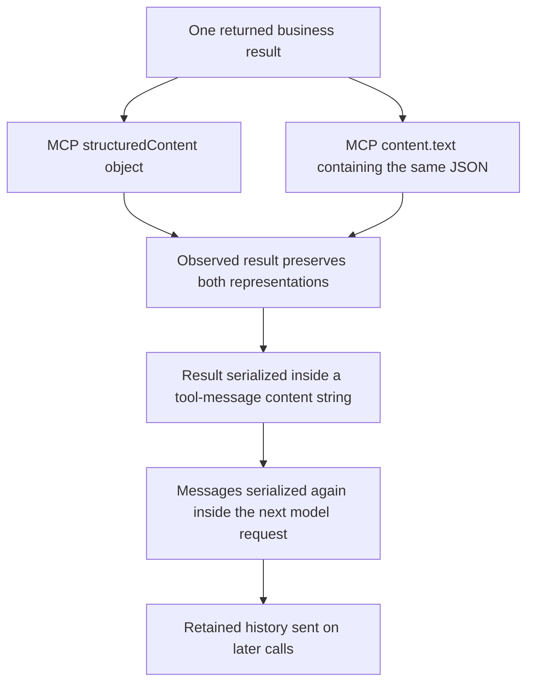

# Why the harness context is bloated: measured analysis

See the [glossary](GLOSSARY.md#7-memory-context-and-token-usage) for context,
projection, cache, payload and native-pass terminology.

Audit date: October 22, 2026. This is an analysis of the current implementation,
not a claim that context efficiency has already been fixed. No runtime source
was changed during this audit. Patient values, handbook excerpts, credentials
and private prompt bodies are excluded from this shareable report.

## 1. Main finding

The harness currently behaves largely as a **bounded transcript replay system**:
it resends a full tool catalog, substantial fixed instructions, a growing ledger,
and as much tool history as its character limit permits. It does not yet build
a small, stage-specific working view of the case.

Several effects compound that design: duplicated MCP representations, verbose
case/document responses, repeated evidence rehydration, JSON escaping, a fresh
native session for every logical call, and sometimes multiple native inferences
within that one logical call. The problem is primarily repeated input, not a
large final answer or an observed model context-window overflow.

## 2. What was measured

Primary execution: `20261022-post-judge-repair-t012-01`, actor source `9fd27cd`.
This is the fresh t012 attempt that actually submitted its authorization.

| Recorded quantity | Value |
| --- | ---: |
| Logical workflow model calls | 19 |
| Engine operations | 57 |
| Reported input tokens | 1,270,858 |
| Reported output tokens | 8,842 |
| Reported total tokens | 1,279,700 |
| Reported cached input tokens | 359,424 |
| Reported reasoning output tokens | 3,343 |
| Logged message-content characters across calls | 1,912,334 |
| Reconstructed serialized engine-payload characters across calls | 2,915,546 |

Cached input is a subset of reported input, and reasoning output is a subset
of output. Do not add either subset again to obtain total tokens. Cached input
was approximately 28.3% of input. These are native-runtime usage reports, not an
API invoice or a directly established dollar cost for Codex sign-in usage.

I reconstructed every projected input message list from saved case state,
message order, evidence and bindings. **All 19 reconstructed message lists match
the original recorder's SHA-256 context fingerprints.** The same pinned runtime
was used for fresh, read-only provider schema discovery; its 38-tool list matches
the declared tools in every one of the 19 calls. No chart/case operation was
performed in that discovery world, and it was stopped afterward.

The original events did not save every native usage update or phase. Four
additional diagnostic model calls investigated that boundary: two tiny synthetic
controls and two inference-only replays of one saved input. Proposed operations
from the replays were **never dispatched**. Total reported diagnostic usage was
181,389 input and 677 output tokens through existing Codex sign-in; no paid judge
or provider-key call occurred. Private scripts, numeric receipts and projected
inputs remain ignored under `HealthHarnessCodex/runs/20261022-context-audit/`.

## 3. Exact prompt composition

These percentages partition **serialized engine-payload characters**, not native
tokens. Raw text components plus schemas and framing/escaping sum to the total.

| Component across all 19 calls | Characters | Share |
| --- | ---: | ---: |
| Prior tool-result content retained in working history | 1,346,469 | 46.18% |
| Full tool schemas and descriptions | 688,522 | 23.62% |
| Fixed system/responsibility instructions | 233,358 | 8.00% |
| Current ledger, contract, bindings and evidence index | 174,012 | 5.97% |
| Fixed user/task instructions | 103,949 | 3.57% |
| Other historical message content | 53,425 | 1.83% |
| JSON escaping, framing, call arguments and remaining metadata | 315,811 | 10.83% |
| **Total** | **2,915,546** | **100%** |

The final row is an aggregate over repeated calls, not a single prompt.
Native Codex instructions, output-schema handling and other runtime context
are outside this engine-payload character partition.

## 4. Cause A: the same MCP result is represented twice

**Confirmed.** In 23 recorded results, the MCP `content` array contains a text
block whose JSON parses to exactly the same object as `structuredContent`.
Keeping both is useful for protocol interoperability, but the harness currently
includes both in the model-facing observation.

The duplicated text blocks contain 337,453 characters across those source
observations. Their model-facing cost is larger than a one-time copy because
of escaping and replay across calls.

**Measured counterfactual:** I removed only exact duplicate text representations
from copies of the already-frozen 19 projected contexts, leaving each structured
object and all original saved observations intact:

| Frozen-context calculation | Characters |
| --- | ---: |
| Original serialized payload total | 2,915,546 |
| After exact duplicate removal | 2,228,628 |
| Reduction | 686,918 / **23.56%** |

This is a lossless representation comparison for those inputs. It is **not** a
measured token reduction, quality result, or live-run saving. The current greedy
projector could refill freed space with more history, limiting the eventual
saving unless its packing policy also changes.

Implementation location: [`engine.py`, observed-result message construction](../HealthHarnessCodex/health_harness_codex/engine.py).

## 5. Cause B: full tool discovery becomes a permanent prompt tax

**Confirmed.** All 38 tools were supplied in every call. Their compact serialized
definitions occupy **36,238 characters per call**, or **688,522 over 19 calls**.
The catalog includes descriptions, argument schemas, effect declarations and
identity-field information. Some tool names are also repeated in the native
output schema and in evidence/history metadata.

Only 20 of those tools were proposed during this attempt; 18 were never proposed.
That does not prove the other 18 can always be removed: they are available
options, and hindsight is not a valid production routing rule. It does show the
current design sends a broad catalog rather than selecting tools by current
stage and providing safe access to others when needed.

The largest definitions include case creation, authorization submission,
provider disposition and evidence-upload tools. No single description accounts
for the whole problem; the repeated full collection does.

**Controlled native measurement:** with the same tiny synthetic messages and
empty proposed-tool response, the no-tool request reported **6,532 input tokens**;
the 38-tool request reported **15,431**. The catalog plus corresponding output
schema therefore added **8,899 reported input tokens** in this paired experiment.
Both controls completed in one native inference and returned zero operations.

Caching tool discovery in Python would save discovery work but would not remove
this model-input cost if all schemas are still serialized into every request.

Implementation locations: [`engine.py`, `_available_specs`](../HealthHarnessCodex/health_harness_codex/engine.py),
[`context.py`, `_tool_schemas`](../HealthHarnessCodex/health_harness_codex/context.py),
[`codex_provider.py`, payload and output-schema construction](../HealthHarnessCodex/health_harness_codex/codex_provider.py).

## 6. Cause C: operational readbacks include large background payloads

**Confirmed.** The benchmark legitimately returns rich record views. Our
model-facing projection does little to distinguish a small state change from
the rest of that returned background.

Examples measured without exposing their patient values:

| Returned material | Observed size/contribution |
| --- | --- |
| Largest `cases.get_case` result | 146,559 serialized characters, including both MCP representations |
| Shared workspace artifacts inside that result | 29,987 characters in the structured field alone |
| Submission-bundle result | 94,476 serialized characters |
| Its structured package-artifact field | 28,092 characters |
| Patient-chart result | 70,106 serialized characters |
| Its structured summaries field | 16,191 characters |
| Five case-readback tool messages combined | 333,202 stored message-content characters |

Several tools echo related forms, questionnaires, summaries and document
artifacts. These are not necessarily identical whole results: operational state
changes between reads. Nevertheless, most unchanged background facts can be
repeated when the next decision primarily needs current status, missing
requirements, a packet reference or a changed form-validation result.

The fix must **not** be to remove needed verification reads. Fresh readback is
part of correct execution. The opportunity is to retain the full returned
evidence in the audit store while giving the model a source-linked working view
and relevant changes. Earlier versions of the same operational record should
also be clearly distinguished from its latest state.

## 7. Cause D: compaction is reactive and tries to refill the budget

**Confirmed from code and reconstructed inputs.** `project_context` does this:

1. Always include the original system and task messages.
2. Add the current ledger and the whole local completion contract.
3. Include the full available tool catalog in its size calculation.
4. Keep raw history if it fits.
5. Otherwise prioritize the newest complete turn, then fit older raw or compacted
   groups until the character budget is nearly used.

The configured budget for this run was 180,000 estimated serialized characters.
Actual compact engine payloads ranged from **61,074 to 177,431 characters**.
**13 of 19 calls exceeded 170,000 characters.**

| Call | Logged message-content characters | Reconstructed engine payload |
| --- | ---: | ---: |
| 1 | 23,902 | 61,074 |
| 4 | 50,961 | 95,648 |
| 19 | 117,436 | 177,187 |

The policy answers “what recent history can fit?” rather than “what evidence and
state does this particular decision need?” Free space is treated as capacity to
fill. Simply increasing the context limit would permit more replay; it would
not remove the repeated data or establish better reasoning.

Compacted tool previews are normally only **240 characters**, despite a
`large_tool_chars=2500` parameter appearing in the function signature. The
preview takes the beginning of the serialized response. That beginning may
contain wrappers/metadata rather than the relevant clinical or workflow fact.
The model then has to search and rehydrate the stored result.

Implementation: [`context.py`, `project_context` and `_compact_group`](../HealthHarnessCodex/health_harness_codex/context.py).

## 8. Cause E: evidence retrieval produces another replay layer

**Confirmed, with an important qualification.** This attempt proposed
**21 `case.search_evidence` calls and 8 `case.read_evidence` calls**. There were
**zero exact duplicate retrieval proposals** under the audit's tool/source/query/
offset key. It is inaccurate to describe them all as pointless identical retries.

Their returned excerpts still enter history and can be replayed alongside
previews or full versions of the original source. Across the frozen model
inputs, local evidence-search results contributed **200,489 characters**, and
evidence-read results **155,987**: **356,476 combined**.

This is about 26.5% of retained tool-history content. The original observation
may also appear elsewhere. Literal substring search, source-offset reading and
short beginning-of-result previews provide access, but are not a concise,
maintained representation of relevant case facts.

Retrieval being available is therefore different from retrieval being efficient.
It should preserve source provenance while reducing the amount the owner must
repeatedly locate and carry forward.

## 9. Cause F: fixed instructions and a verbose ledger repeat every turn

**Confirmed, but smaller than tool history and schemas.**

- The system/responsibility message is **12,282 characters**, repeated 19 times.
- The task/operational instruction message is **5,471 characters**, repeated
  19 times. This includes our guidance, not just the clinical intake text.
- The ledger grows from **6,090 to 10,830 characters**.
- The complete local completion contract alone is **4,867 characters** each
  turn. It repeats requirements and identity/readback predicates in JSON.
- The final evidence index contributes **4,473 characters** to the ledger.

For PA the prompt includes 18 PA responsibility definitions plus 10 shared
definitions—not all 66 definitions and not 66 running workers. Those
instructions are a real repeated cost, but blaming all usage on a 66-agent team
would misdescribe the implementation and the measurements.

The code can enforce the full completion contract without necessarily displaying
its entire predicate structure every turn. A concise view of remaining
milestones could guide the model while the complete contract remains immutable
in the controller. That change must preserve explicit boundaries and useful
failure feedback; deleting safeguards indiscriminately is not justified.

## 10. Cause G: serialization and measurement boundaries hide additional size

**Confirmed.** The engine puts an observed result inside a JSON string in a tool
message. The Codex adapter then serializes the messages into another JSON
payload and sends that payload inside a text instruction.

Nested quotes and backslashes therefore have to be escaped. The audit counted
**183,142 characters of content-string escaping overhead** across the 19 inputs.
Other message framing, IDs, call arguments and metadata account for the rest of
the 315,811-character residual in the main table. The adapter's outer instruction
adds **1,066 characters per request**, and the current native output schema adds
another schema outside the engine payload.

The existing `context_characters` metric only sums `message.content` lengths.
It excludes tool schemas, message framing and the native wrapper. Its recorded
1,912,334 characters therefore do not describe the full 2,915,546-character
engine payload, let alone the entire native request context. The metric is
valid for message contents but insufficient for diagnosing overall input size.

Implementation locations: [`evaluation.py`, `RecordingModel.complete`](../HealthHarnessCodex/health_harness_codex/evaluation.py),
[`engine.py`, tool-message construction](../HealthHarnessCodex/health_harness_codex/engine.py),
[`codex_provider.py`, `complete` and `_start_turn`](../HealthHarnessCodex/health_harness_codex/codex_provider.py).

## 11. Native Codex introduces a separate inference multiplier

**Confirmed multiplier; exact trigger not established.** Every logical owner
call starts a new owned process/thread and resends the selected engine context.
Even a tiny 279-character engine payload with no tools reported 6,532 input
tokens in the control. That total includes the native runtime/instruction
envelope, visible wrapper and schema; it is not a measurement of pure hidden
system-prompt size.

One inference-only replay of the exact saved call-14 input produced two native
usage updates:

| Native pass | Input tokens | Output tokens |
| --- | ---: | ---: |
| First `last` usage | 53,098 | 117 |
| Second `last` usage | 53,230 | 215 |
| Final cumulative `total` | **106,328** | **332** |

The second pass reported 52,864 cached input tokens. Our adapter returns the
runtime's cumulative `total`, rather than adding the two cumulative updates.
Thus this reproduced 2x case is **not simple duplicate addition by our recorder**.
It reflects two separately reported native input passes inside one logical
harness completion.

A second replay of the same payload produced a single pass with **53,098 input
tokens**. That trace contained one final-answer message. The first replay did
not capture phase metadata, so attributing its additional pass specifically to
commentary, output-schema repair, retries or another internal continuation would
be speculation. The historical final-only event logs cannot recover that cause.

This means a logical call count of 19 is not proof of exactly 19 native input
passes. Future instrumentation should record native per-pass usage and phases,
without storing private model reasoning. Do not halve historical reported usage
or relabel it as a counting error without further evidence.

Fresh sessions serve an isolation/control purpose. A persistent per-case
connection might reduce repeated work, but simply keeping a thread alive while
resending the whole history could make duplication worse. Any such change must
send appropriate deltas, retain scope checks and forbid cross-patient reuse.

## 12. What is not established as the cause

- **No context-window overflow was observed** in this run. This is an efficiency
  and working-set selection problem, not evidence that the model needs a larger
  context window.
- Output was only about **0.69% of reported total tokens**. Lowering reasoning
  effort alone does not remove the dominant repeated input.
- No helper call or simulator model call occurred in this execution. A hidden
  66-agent conversation is not responsible for the measured usage.
- The whole protected handbook is not automatically inserted. Retrieved
  material can be large, but a full-library preload is not shown by this audit.
- The OpenRouter judge's usage is separate. Its paid session does not explain
  these actor input-token figures.
- Cache was not absent: 359,424 input tokens were reported cached. Fresh threads
  do not prove caching is disabled. The exact cause of cache misses is unmeasured.
- High disk usage from retaining evidence and rendered messages is not the same
  as putting the entire database into every model call.

## 13. Recommended repair order

These are proposed changes, not implemented savings.

| Priority | Change | Why this order / necessary constraint |
| --- | --- | --- |
| 1 | Normalize exact duplicate MCP text/structured representations in model-facing views | Directly measured, lossless opportunity; preserve the original raw observation and nonduplicate content |
| 2 | Replace fill-the-budget history packing with a compact current-case working view | Otherwise freed space can be filled with more history; preserve source IDs, uncertainty, latest state and access to full evidence |
| 3 | Make tool presentation stage-aware, with safe discovery/activation of other allowed tools | Removes repeated schemas that are irrelevant to the present decision; do not use hindsight or hide required recovery actions |
| 4 | Show concise remaining milestones instead of the full repeated contract JSON | The controller must retain and enforce the full pinned contract independently |
| 5 | Give retrieval better source views and relevance, and avoid replaying excerpts indefinitely | Reduce search/rehydration burden without replacing source evidence with unsupported model summaries |
| 6 | Trace native passes/phases and test final-only or connection strategies | The multiplier is measured but its trigger is not; do not weaken native tool/instruction restrictions or patient isolation |
| 7 | Measure raw and serialized component sizes, native passes, cache and results together | Prevent a smaller character log from being mistaken for a better, cheaper or equally correct harness |

Validation should retain the same case evidence and completion requirements,
compare actual task outcomes, and report input tokens, native passes, call count,
retrieval count and quality separately. The 23.56% offline character reduction
is a useful starting measurement, not a forecast of the final improvement.
