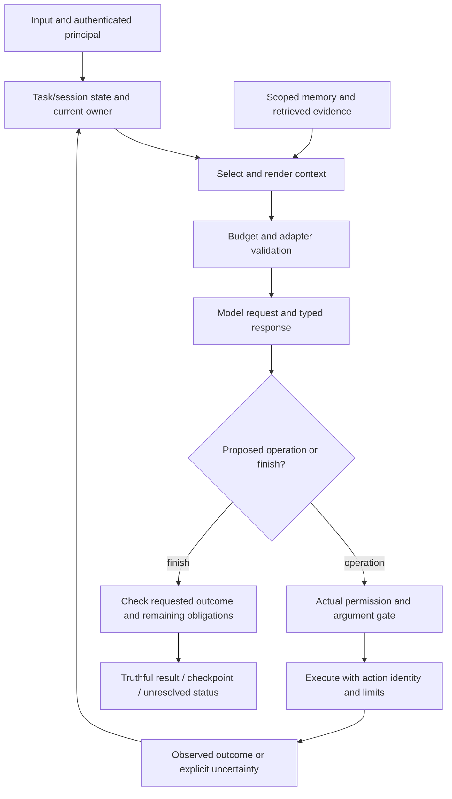
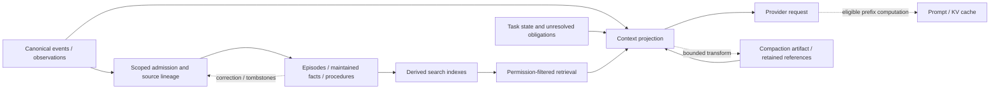
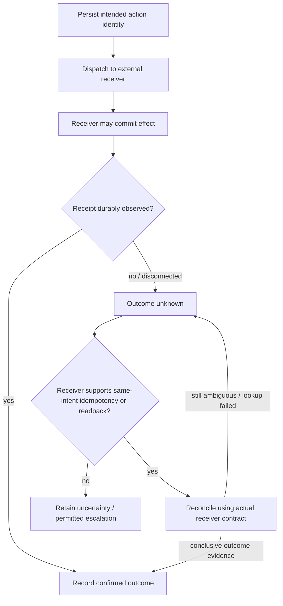

# General mechanism maps

These are explanatory engineering models, not extracted complete call graphs or a selected architecture. They show boundaries to reason about. Particular runtimes may combine components or delegate them to a provider. The [general chapters](README.md) explain alternatives and evidence limits.

## A tool-using execution cycle

The model chooses a proposal; host software mediates effects. A stop signal, delivered message and verified task result are distinct events. This does not imply every step needs another model call.

## Storage and model-visible context

Stored, indexed, selected, trusted and currently authorized are different properties. Compaction can change the model view without erasing retained events. A cache is not a semantic knowledge store. Whether a real implementation persists a pruning projection must be checked rather than assumed.

## A lost-acknowledgement recovery problem

A local checkpoint does not atomically include that receiver's effect. Reconciliation can remain inconclusive; attempts need a bounded policy and must retain uncertainty when that budget is exhausted. A stale worker can also return after takeover, so result publication needs an ownership/version policy. The synthetic lab demonstrates a narrow supported-receiver example and an explicit duplicate-effect counterexample; it does not implement a distributed guarantee.
