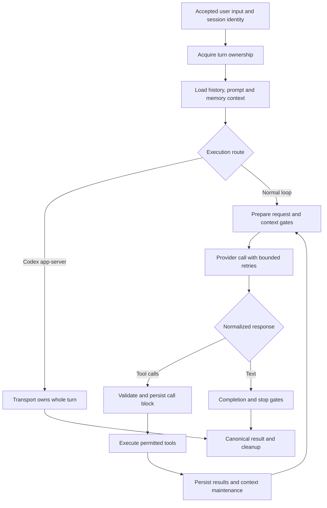

# Execution: follow one turn rather than one marketing feature

[Index](README.md) · [Context](CONTEXT.md) · [Memory](MEMORY.md) · [Operations](OPERATIONS.md) · [Limits and lessons](LIMITS_AND_LESSONS.md)

## Core call path

`run_agent.py` is the public `AIAgent` facade, with implementation distributed across `agent/` siblings. The inspected normal path is `AIAgent.run_conversation` → turn admission/lease → `agent.conversation_loop.run_conversation` → `_run_conversation_turn`. Construction wiring lives in `agent/agent_init.py`. This shape matters when extending or debugging: the facade is not the entire harness, and moving everything into a single loop would hide its state contracts.

Inside `_run_conversation_turn`, the agent refreshes eligible client credentials, builds or restores turn context, binds route-specific state and resets retry/turn counters. It then creates loop state. An explicit `codex_app_server` execution route can hand the entire turn to that transport; the usual local tool loop is therefore not the only execution owner. The normal loop runs iteration preparation, request assembly, preflight gates, interruptible API/retry handling, response normalization, then either a tool round or text-response completion. Breaks and exhausted budgets flow to finalization; typed early results also exist. [H001: actual loop](https://github.com/NousResearch/hermes-agent/blob/e6f57427c198cfd96854522b7a9159eb007e13c2/agent/conversation_loop.py#L1555-L1715).

The diagram is a reconstruction of selected source paths, not an exhaustive state machine. It omits many retry/recovery branches and does not establish that all responses satisfy the user's actual task.

## Side effects have a durability boundary

`run_tool_round` validates emitted tool names and arguments, expands supported batched calls, deduplicates/caps calls, stages the assistant tool-call message, then flushes that message to session storage **before executing tools**. If canonical persistence fails, the turn stops. If result persistence fails later, that in-memory result must not silently become the next model's canonical context. [H002: persist-before-dispatch](https://github.com/NousResearch/hermes-agent/blob/e6f57427c198cfd96854522b7a9159eb007e13c2/agent/turn_tool_round.py#L109-L178).

This solves one failure: a tool restarts the process, but the resumed transcript has no record that it was requested. It does not solve the different failure in which a remote action succeeds and the process dies before storing its receipt. For an external submission, payment or message, a construction guide still needs operation IDs, idempotency support, external-state reconciliation and an explicit `unknown` outcome. Transcript persistence alone cannot provide a distributed transaction.

Tool execution is also more nuanced than “all tools run sequentially.” The current executor has sequential, concurrent and segmented paths. A mixed batch can preserve barrier order while independent segments run concurrently; returned result order is maintained. Sequential calls themselves can use worker threads for timeout/cancellation handling. The maintained lesson is to parallelize only operations whose dependencies and shared mutations permit it. [Current segment executor](https://github.com/NousResearch/hermes-agent/blob/e6f57427c198cfd96854522b7a9159eb007e13c2/agent/tool_executor.py#L1926-L1950). This additional path was inspected, but not stress-tested.

## Session ownership is separate from agent intelligence

The turn lease has a 300-second TTL and a default 60-second renewal interval. It separately wires an activity watchdog. Renewing a lease is evidence that an owner still holds authority; it is not evidence that its provider stream or tool is making useful progress. Loss of the lease triggers interruption. [H003: lease implementation](https://github.com/NousResearch/hermes-agent/blob/e6f57427c198cfd96854522b7a9159eb007e13c2/agent/turn_facade_lease.py#L22-L106).

For a new harness, define three independent clocks: ownership expiry, wall-clock task deadline and inactivity deadline. An active long-running tool may exceed a short wall budget; a silent model stream may renew ownership forever unless inactivity is separately detected. Cancellation should distinguish “interrupt requested,” “worker stopped” and “external action reconciled.” Hermes illustrates this distinction; the exact timeout choices are product-specific.

## Provider adapters are contracts, not a provider-name switch

Hermes normalizes responses through a transport registry. Bundled discovery includes Anthropic, Codex, chat-completions and Bedrock; plugins can register additional API modes. The separate Codex app-server route demonstrates that some transports own a whole agent turn rather than only an HTTP completion. [H004: registry](https://github.com/NousResearch/hermes-agent/blob/e6f57427c198cfd96854522b7a9159eb007e13c2/agent/transports/__init__.py#L17-L56).

Provider runtime documentation describes shared resolution across CLI, gateway, cron, ACP and auxiliary calls. At its stated high level, explicit runtime selection precedes saved model/provider config, environment and provider defaults. Provider plugins declare endpoint, API mode, environment-variable priorities and fallback metadata. This is documentation-level coverage; the full credential-refresh and custom-endpoint matrix was not individually verified. [H005: runtime guide](https://github.com/NousResearch/hermes-agent/blob/e6f57427c198cfd96854522b7a9159eb007e13c2/website/docs/developer-guide/provider-runtime.md#L8-L54).

A transferable adapter contract should represent tool calls, visible text, reasoning/opaque replay items, stop reason, usage buckets, errors and interruption explicitly. “OpenAI-compatible” is not sufficient to assume identical tool schemas, reasoning replay, usage accounting, context limits or cache behavior. Provider fallback can change those contracts as well as quality and price. Rebuild the relevant token/context policy when the active model changes; do not reuse a context-size assumption merely because the outer API shape is similar.

## Budgets and stopping

The normal loop checks both local API-call count and `IterationBudget.remaining`, with a bounded grace-call mechanism. The turn setup resets per-turn counters. Delegated children currently receive fresh budgets, not the parent's shared budget; the documented discrepancy is discussed in [limits](LIMITS_AND_LESSONS.md). Each child defaults to 250 configured iterations; a model-supplied conflicting maximum is ignored in favor of operator configuration. [H038–H040: child construction and cap](https://github.com/NousResearch/hermes-agent/blob/e6f57427c198cfd96854522b7a9159eb007e13c2/tools/delegate_tool.py#L229-L313), [configuration enforcement](https://github.com/NousResearch/hermes-agent/blob/e6f57427c198cfd96854522b7a9159eb007e13c2/tools/delegate_tool.py#L520-L540).

Consequently, an individual-child cap does not establish a tree-wide cost cap. A new harness must specify whether calls, tokens, money, tool calls, concurrency, elapsed time and spawn depth are local or aggregate. A text answer is an execution outcome, while verified task completion is an application-level condition. Keep those statuses separate in logs, benchmark evaluation and user reports.
