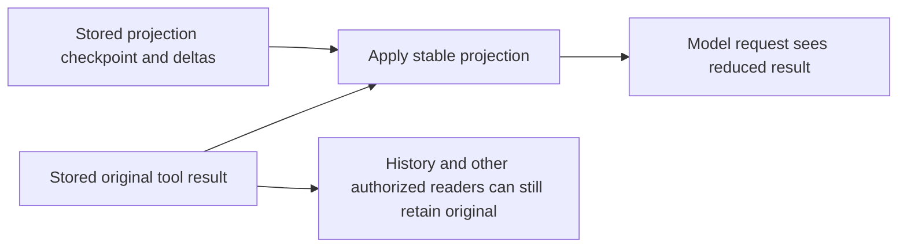

# Context management: assembled, projected and persisted state

“Context” is the actual input available to a particular model request. It is not identical to the saved conversation, all files on disk, a vector database or everything an agent has ever observed. The OpenClaw source makes these differences explicit in several separate layers.

## Prompt assembly

`system-prompt.ts` supports full, minimal and none modes. Skills and memory sections are derived from capabilities the agent can actually call. Bootstrap/context files are ordered and prepared into prompt sections. Attempt preparation additionally considers runtime/sandbox/model information and current tool policy. [OC-008](EVIDENCE.md#oc-008), [OC-009](EVIDENCE.md#oc-009), [OC-010](EVIDENCE.md#oc-010).

This is why “give each subagent a role prompt” is only one part of context design. Its effective instructions, tool schemas, retrieved material, recent history and current task also consume the model's request budget. Full parent inheritance and a narrow fresh task have different cost and contamination tradeoffs.

The bootstrap helper defaults to 20,000 characters per ordinary file and 60,000 total, with a separate 4,000-character `USER.md` limit. These are **character budgets**, not exact tokens. The budget report distinguishes per-file truncation, total truncation and near-limit pressure. Raising a total limit does not remove the fixed `USER.md` cap. [OC-011](EVIDENCE.md#oc-011), [OC-012](EVIDENCE.md#oc-012).

System-prompt reporting records rendered prompt inputs, injected file sizes and tool schema/summary accounting. Such instrumentation helps explain why requests are large; it does not demonstrate that a model used the relevant information. [OC-013](EVIDENCE.md#oc-013).

## Multiple budgets, multiple failure modes

| Budget or bound | Why it exists | What it does not imply |
| --- | --- | --- |
| Per-file/total bootstrap character budget | Bounds always-present instructions and personal/core context | Exact model tokenizer accounting |
| Foreground request budget | Fits instructions, history, schemas, pending input and output reserve | All saved history is visible |
| Summary model context window | Lets the summarizer read older material | Foreground model's window has grown |
| History hydration byte cap | Bounds resource use when replaying serialized events | Token window is full; data has been deleted |
| Active transcript byte-pressure threshold | Optional semantic-maintenance trigger | General disk-retention limit |
| Tool-result projection budget | Prevents large repetitive outputs dominating input | Original tool result has been erased |

The host documentation explicitly accounts for fixed instructions, tools, pending input and output reserve when choosing compacted history. A larger summarization model cannot solve an oversized foreground fixed prompt. When fixed instructions alone exceed the model's window, resetting history cannot make them fit. [OC-028](EVIDENCE.md#oc-028).

The low-level compaction library defaults to enabled, reserve 16,384 tokens and recent-tail budget 20,000. These are **library defaults**, not a claim that every host/runtime turn uses those exact effective settings. Host configuration, model output limits and provider-native compaction can change the result. Local planning also uses a 1.2 safety margin for estimation and strips runtime-only context/private result details from summary estimates. [OC-026](EVIDENCE.md#oc-026), [OC-027](EVIDENCE.md#oc-027).

## Context engines are a separate extension point

The default plugin slots are `memory-core` for memory and `legacy` for context. They are not one plugin or one interchangeable responsibility. [OC-015](EVIDENCE.md#oc-015).

The default legacy engine's ingest is a no-op because the session manager owns persistence. Assembly returns the current messages and delegates estimation/sanitization/limits to the existing host path; compaction delegates back to the built-in runtime. That is not proof that all custom engines are pass-through. [OC-016](EVIDENCE.md#oc-016).

The contract supports bootstrap, ingest/batch ingest, maintenance, after-turn work, assembly, compaction and disposal. `AssembleResult.estimatedTokens` is advisory: it does not disable host request admission. It can also specify per-turn projection versus bootstrapping a persistent backend thread with an epoch. [OC-014](EVIDENCE.md#oc-014), [OC-017](EVIDENCE.md#oc-017).

General lesson: a custom retrieval/context engine may choose content, but a host still needs its own model-window and lifecycle contract. A plugin claiming “I already compacted” cannot automatically establish that fixed prompt plus new input fits.

## Pruning: projecting old tool outputs

The client pruning resolver is enabled by `mode: "cache-ttl"`. Its local default TTL is five minutes, hard-clear is enabled unless overridden, and deny/allow filters select tool names. A large result's soft projection keeps its first and last 1,500 characters with a marker. [OC-021](EVIDENCE.md#oc-021), [OC-022](EVIDENCE.md#oc-022).

The specific pruning guide documents the following client path: after TTL expiry, estimate context usage; at roughly 30% pressure soft-trim oversized eligible results; if pressure remains around 50% with at least 50,000 prunable characters, hard-clear eligible results to a placeholder. It protects the last three assistant turns and bootstrap reads before the first user input. Those threshold details are documentation-backed in this audit; the whole branch matrix was not executed. [OC-024](EVIDENCE.md#oc-024).

Provider/authentication route matters. The pinned guide describes direct Anthropic API-key requests using server tool-result clearing while eligible proxy/OAuth/other routes use local TTL pruning. Anthropic-specific setup can seed one hour instead of the generic local five-minute resolver default. Do not copy one number without its activation and call-site conditions. [Pinned pruning guide](https://github.com/openclaw/openclaw/blob/3b3492490602f5080d3fbe7d2df9618cdb82ea9a/docs/concepts/session-pruning.md).

**Important correction:** pruning is not simply “temporary and never persisted.” `persistToolResultProjections()` serializes changed views into hidden `openclaw.cache-ttl` markers. Later runs can restore the same projected bytes without rewriting original result rows. One table in `concepts/compaction.md` still labels pruning “in-memory only, per request,” which is too broad for this implementation. [OC-023](EVIDENCE.md#oc-023), [OC-024](EVIDENCE.md#oc-024), [OC-025](EVIDENCE.md#oc-025).

The precise model is:

Pruning tests were inspected for invalid-TTL fallback and explicit `1h` parsing. They were not run. [OC-075](EVIDENCE.md#oc-075).

## Compaction: semantic replacement of active history

Compaction creates a semantic summary/retained suffix or an eligible provider replay window. It changes the active model conversation representation. It is lossy: exact identifiers, qualifications and pending requests can be omitted despite prompts and checks. The source's strict identifier guidance is a mitigation, not a guarantee. Native backend ownership can require a different procedure from the built-in SQLite compactor. [Compaction contract](https://github.com/openclaw/openclaw/blob/3b3492490602f5080d3fbe7d2df9618cdb82ea9a/docs/concepts/compaction.md), [OC-072](EVIDENCE.md#oc-072).

Pre-compaction memory flush is another operation, with another store and policy, discussed in [memory](MEMORY.md). A summary in the session does not automatically become a durable, trusted fact.

## History omitted without compaction

The guide documents a separate hydration cap: eight times the effective context-token budget in serialized bytes, at least 1 KiB and at most 64 MiB. It can advance a retained prefix in chunks while preserving complete turns/tool associations and a latest summary. This is a resource-selection policy, not a tokenizer calculation. Older stored events can therefore be absent from a request even when its token budget has room. [OC-029](EVIDENCE.md#oc-029).

An opt-in active-transcript byte guard requests semantic compaction before a run; unsuccessful maintenance can fall back to a bounded recent-history view. It does not claim the missing history was summarized, delete it, or establish a storage-retention promise. [OC-030](EVIDENCE.md#oc-030).

## Questions worth carrying into any harness design

- Which input was actually sent on this request, and can we reconstruct it with its policy/model revision?
- Are token estimates locally inferred, provider measured, fresh, or inherited from an older turn?
- Which content was omitted, projected or summarized, and is that distinction visible in diagnostics?
- Does a checkpoint still match the exact provider, model, endpoint and prefix?
- Can all required constraints and unresolved work survive compaction in a structured artifact outside the summary?
- Does retrieval independently preserve scope and freshness rather than reintroducing a stale compacted assertion?

These are engineering research questions, not claims that any given memory or compaction design answers them perfectly.
