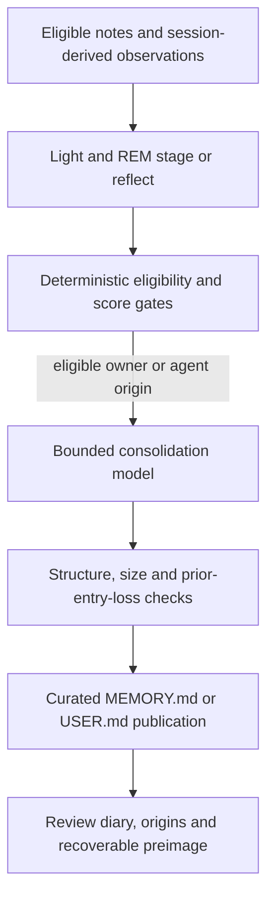

# Memory: separate stores, write paths and recall paths

OpenClaw's current Memory Core is an example of file-based durable knowledge with database-backed indexing, provenance and maintenance. That is more precise than saying either “it remembers Markdown” or “it uses a vector database.” The default memory slot is `memory-core`; another selected plugin can own a different storage and tool contract. The default context-engine slot remains `legacy`, separately. [OC-015](EVIDENCE.md#oc-015).

## State surfaces and their meaning

The pinned architecture describes these tiers. The table paraphrases its contract; it is not an assertion that every enabled deployment populates every tier. [OC-042](EVIDENCE.md#oc-042).

| Surface | Purpose | Normal context behavior | Main risk to reason about |
| --- | --- | --- | --- |
| Workspace instructions such as `AGENTS.md` | Operator-authored behavioral instructions | Bootstrap/session context | Oversized, conflicting or untrusted edits |
| `MEMORY.md` and `USER.md` | Small curated facts/user model | Eligible provenance and budget govern bootstrap | Stale or wrongly promoted assertion becomes frequently available |
| `memory/YYYY-MM-DD.md` | Append-friendly observations and pre-compaction notes | Retrieved when relevant, not wholesale bootstrap | Noisy, mixed-trust or contradictory material |
| Session transcript | Recorded conversation and tool history | Selected replay or scoped retrieval | Sensitive retention, stale events, context overflow |
| Search index/chunks/embeddings | Derived retrieval representation | Search result snippets | Delayed index freshness, scoring mismatch, unauthorized audience |
| Provenance and origin rows | Host-recorded trust and source lineage | Used in selection/promotion/deletion | Missing or incomplete attribution |
| Standing intents and cron state | Future/event-conditioned work | Triggered instructions/work | Scheduling or duplicate-effect semantics |
| `DREAMS.md`, reports and preimages | Human review and recovery | Not intended as automatic semantic instruction source | Retained copies and accidental feedback into memory |

The documentation's “no hidden state” principle should be read as inspectable memory artifacts, not a literal claim that every harness state bit is in Markdown. Session state, origins, recall metadata and schedules also live in databases. Confusing these claims would hide precisely the state a reliable harness needs to audit. [OC-018](EVIDENCE.md#oc-018), [OC-042](EVIDENCE.md#oc-042), [OC-050](EVIDENCE.md#oc-050), [OC-069](EVIDENCE.md#oc-069).

## How new knowledge enters memory

There are distinct paths:

1. The working agent can append permitted observations to daily notes.
2. A pre-compaction flush can preserve unwritten context to a daily file.
3. Eligible session ingestion/backfill can stage attributable transcript-derived entries.
4. A background dreaming/consolidation pipeline can promote eligible material into curated memory.
5. A direct user instruction or external writer can change a workspace artifact through its own permitted surface.

Only paths covered by the relevant instrumentation have complete tracked entry lineage. A plain local file edit does not magically acquire a source-session origin record. Source admission exclusions also do not become filesystem access controls. [OC-042](EVIDENCE.md#oc-042), [OC-051](EVIDENCE.md#oc-051), [OC-052](EVIDENCE.md#oc-052).

## Pre-compaction flush

Memory Core constructs an append-only daily-note prompt. The prompt explicitly treats `MEMORY.md`, `USER.md`-related bootstrap context, `DREAMS.md`, `SOUL.md` and `AGENTS.md` as reference/curated surfaces rather than unrestricted replacement targets during the flush. Its plan targets `memory/<timezone-resolved date>.md`. The inspected prompt explicitly names `MEMORY.md`, `DREAMS.md`, `SOUL.md` and `AGENTS.md`; the larger bootstrap restriction is a policy boundary that should be checked against the effective tool writer, not assumed from the prose alone. [OC-031](EVIDENCE.md#oc-031), [OC-032](EVIDENCE.md#oc-032).

At this revision the plan defaults to a 4,000-token soft threshold and 2 MiB transcript-byte pressure, computes an effective reserve for the context window, supports an exact model override, and can be disabled. The gate tracks the compaction counter to avoid repeatedly flushing the same cycle. These parameters govern when to consider housekeeping; they do not prove a useful fact was saved. [OC-031](EVIDENCE.md#oc-031), [OC-032](EVIDENCE.md#oc-032), [OC-033](EVIDENCE.md#oc-033).

Flush and compaction have separate outcomes. The contract says flush failure is nonfatal maintenance and should not reset/discard the conversation; required compaction failure is reported with history preserved. Another selected memory plugin may declare its own persistence/read tools, with source audience/sandbox restrictions carried into the turn. This cross-plugin behavior is documented, not runtime-tested here. [OC-034](EVIDENCE.md#oc-034), [compaction memory-flush contract](https://github.com/openclaw/openclaw/blob/3b3492490602f5080d3fbe7d2df9618cdb82ea9a/docs/concepts/compaction.md).

General interpretation: a flush is an extraction opportunity before a lossy transformation. It is not permission to store everything forever or to convert every tool output into a trusted fact.

## Search configuration and effective defaults

The normal memory resolver enables search unless disabled. It resolves six results, minimum score .35, .7 vector/.3 lexical weighting, a 4x candidate pool, enabled MMR at lambda .7 and enabled temporal decay with a 30-day half-life. The resolver also sets chunking to 400 tokens with 80 overlap and a default-enabled embedding cache bounded to 50,000 entries. These are implementation defaults, not measured optimal values. [OC-035](EVIDENCE.md#oc-035), [OC-037](EVIDENCE.md#oc-037).

Unset or `auto` embedding provider resolves to `openai` in this code; `none` means FTS-only and bypasses semantic-provider discovery. Resolved configuration does not establish that credentials exist, a remote call occurred or a local embedding model was installed. [OC-036](EVIDENCE.md#oc-036).

The source policy starts from memory files. Session memory requires the corresponding explicit/remember-across-conversations policy; what is indexed can differ from what an explicit query searches. “Index contains it” is not equivalent to “every conversation can retrieve it.” [OC-038](EVIDENCE.md#oc-038).

## Retrieval is more than one similarity score

The hybrid merger combines candidates by chunk identity, preserves provenance, blends lexical and vector signals, and handles exact/partial path specificity, project affinity and ranking/eligibility separately. Temporal decay and diversity reranking then affect ordering. [OC-039](EVIDENCE.md#oc-039).

MMR uses normalized relevance minus redundancy, with token-set Jaccard overlap providing the redundancy signal in the inspected implementation. This can reduce near-duplicate snippets. It cannot decide whether a claim is medically correct, up to date or authorized. [OC-040](EVIDENCE.md#oc-040).

Recency uses exponential half-life decay, while evergreen root/topic memory is exempt. A subtle source-reading trap is that standalone helper defaults for MMR and decay are disabled, but the normal resolver explicitly supplies enabled settings. The effective call site matters more than an isolated constant. [OC-035](EVIDENCE.md#oc-035), [OC-041](EVIDENCE.md#oc-041).

A source timestamp is also not necessarily a fact's effective date. A newly edited file can contain an obsolete claim; a stable old policy can remain valid. That distinction is a general design concern, not an observed OpenClaw defect.

## Active Memory: pre-reply recall as separate bounded work

`active-memory` is a separate plugin with its own enablement, session eligibility, query construction, budgets and read tool allowlist. Its settings resolve enabled unless disabled and default eligible chat type to direct; global plugin policy and session rules still govern whether it runs. It should not be described as a manually installed requirement of every OpenClaw memory deployment. [OC-054](EVIDENCE.md#oc-054).

The plugin hooks `before_prompt_build`, intersects recall tools with current authority and arms a deadline. It invokes a distinct embedded recall run with a memory audience and explicit tool allowlist. The runtime session is SQLite-backed; optional retained JSONL here is a diagnostic transcript artifact, illustrating why the mere existence of JSONL does not identify the primary store. [OC-055](EVIDENCE.md#oc-055), [OC-056](EVIDENCE.md#oc-056).

Current constants include a 15-second ordinary recall budget, a 45-second CLI default, 220-character summary target, 15-second cache, recent-query/escalate mode, and a circuit breaker after three timeouts with a 60-second cooldown. These are bounded recall controls, not guarantees of useful retrieval. [OC-053](EVIDENCE.md#oc-053).

The source explicitly warns that `modelFallback` is a last-resort **selection** candidate when no model resolves; it is not automatic runtime failover when the chosen model errors. Never infer retry behavior from a configuration name alone. [Pinned plugin registration](https://github.com/openclaw/openclaw/blob/3b3492490602f5080d3fbe7d2df9618cdb82ea9a/extensions/active-memory/index.ts#L80-L95).

Tradeoff: an extra recall worker can improve focus yet adds latency/model cost and another failure surface. The code bounds this cost and skips failed recall; benefit on a target task still requires an evaluation.

## Trust and promotion provenance

The host classifies input using metadata, not natural-language assertions of authority. An explicit owner input is `owner`; assistant derivation of it is `agent`; internal runtime input is `system`; other input and tainted assistant derivation are `untrusted`. [OC-043](EVIDENCE.md#oc-043).

Declared network tool output taints the current turn's later assistant content. A new user turn clears the active taint. This depends on tools accurately declaring network-origin results; arbitrary local file content cannot be assumed covered by this mechanism. A deliberately inspected test asserts owner text remains trusted while a network-derived assistant response is downgraded. It was not run. [OC-044](EVIDENCE.md#oc-044), [OC-074](EVIDENCE.md#oc-074).

Promotion has structural gates: untrusted/system origins are blocked; consolidation accepts owner/agent origin, and session-derived candidates must be interactive. That is a provenance rule, not a fact checker. Owner-origin misinformation can still be wrong, and missing declarations can weaken classification coverage. [OC-045](EVIDENCE.md#oc-045).

General lesson: keep provenance outside model-editable prose and retain who/what supported an assertion. Do not treat repeated retrieval of a claim as independent evidence for that claim.

## Dreaming and consolidation

The configuration resolver defaults the sweep and light/deep/REM phases enabled, with a daily `0 3 * * *` schedule. Deep defaults include ten candidates, minimum score .75, three recalls, three distinct queries and a 14-day ranking half-life. These are dated software choices; the source's calibration comments are not an independent benchmark result in this audit. [OC-046](EVIDENCE.md#oc-046), [OC-047](EVIDENCE.md#oc-047).

Configured enablement is not execution. Registration checks selected plugin context, cron availability and enabled state, and logs warnings when the scheduler is unavailable. A stopped Gateway cannot perform background sweeps. [OC-048](EVIDENCE.md#oc-048), [OC-069](EVIDENCE.md#oc-069).

The architecture's intended sequence is:

Source documentation describes a pre-publication content-hash check and atomic replacement, preserving preimages and a readable change diary. A concurrent edit can cause rewrite abort/fallback. The documented remaining filesystem race is an accepted implementation tradeoff, not a formal guarantee against every writer. [OC-049](EVIDENCE.md#oc-049).

The gates aim to prevent external poisoning and low-value automatic noise from becoming evergreen context. They do not establish semantic truth, optimal forgetting or universal protection from prompt injection.

## Forgetting, exclusion and retained copies

`memory forget` resolves explicit session/hook/participant selectors, reads origin lineage and serializes mutation under a workspace lock; dry-run uses a nonmutating branch. We inspected this code without invoking it. [OC-050](EVIDENCE.md#oc-050).

The command is **not global erasure**. Source documentation says it targets identifiable derived memory artifacts, leaves original transcripts intact, may lack coverage of freeform/manual/old writes, and does not control all copies. A failure can leave partial cleanup, requiring report review and retry. Mixed lineage can require deleting a whole attributable entry rather than surgically removing only one contributor's words. [OC-051](EVIDENCE.md#oc-051), [provenance/deletion guide](https://github.com/openclaw/openclaw/blob/3b3492490602f5080d3fbe7d2df9618cdb82ea9a/docs/concepts/memory-provenance.md).

Admission exclusions are prospective and apply to dreaming ingestion/backfill. They are not automatically applied to raw transcript indexing or direct writes, and they do not revoke filesystem permissions. [OC-052](EVIDENCE.md#oc-052).

For any new harness, a meaningful deletion claim therefore needs an inventory of raw events, facts, vectors, caches, summaries, embeddings, child contexts, diagnostic exports, preimages and backups. Which of those stores must be removed is a product/retention requirement, not something a single “forget” API name can decide.

## Unresolved empirical questions

- Does the target workflow benefit more from extraction quality, retrieval ranking or a structured current-case record?
- How often does a promoted fact become stale, and can supersession preserve provenance without hiding disagreement?
- How much latency/cost does pre-reply recall add, and when should it be skipped?
- How quickly do file/transcript changes become searchable under indexing failure and embedding latency?
- Which source declarations and trust boundaries cover actual tools in use?
- Can a forgotten fact be reconstructed from retained originals or an unrelated external source?
- Does an automated metric reward useful recall without encouraging repeated retrieval feedback loops?

None of those outcome questions is settled by this static source audit.
