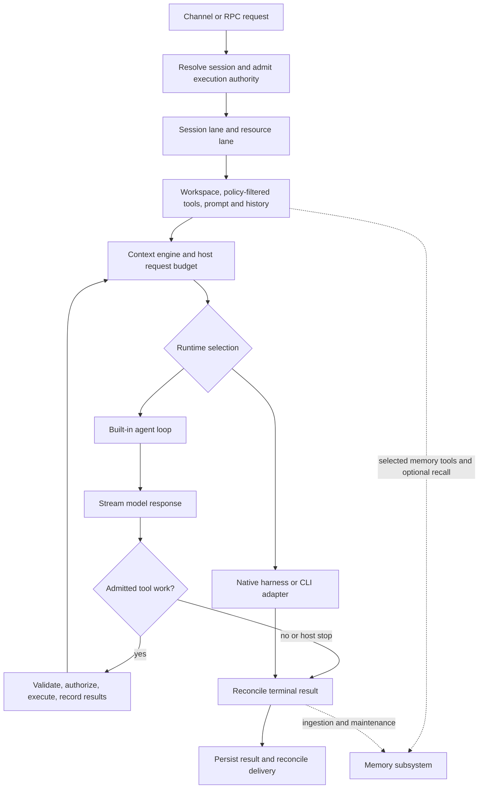

# OpenClaw: a pinned reference implementation

OpenClaw illustrates an agent host that owns considerably more than a model/tool loop: channels and routing, prepared execution authority, queued runs, durable sessions, context projection, multiple runtimes, memory, background work and delivery reconciliation. It is one set of engineering choices to learn from. It is not an industry standard, an exhaustive design space, or a selected blueprint for our own harness.

Source snapshot: official [openclaw/openclaw](https://github.com/openclaw/openclaw), commit **`3b3492490602f5080d3fbe7d2df9618cdb82ea9a`**, reviewed October 18, 2026 (Asia/Calcutta). Its package declares version `2026.10.4`; that does not establish that this main-branch snapshot equals an installed or tagged release. The pinned Node engine range is `>=24.16.0 <25 || >=26.1.0`. [OC-001](EVIDENCE.md#oc-001), [OC-002](EVIDENCE.md#oc-002).

## Read by question

| Question | Read |
| --- | --- |
| How does an incoming request become a run, model calls, tool calls and a finished result? | [Execution and runtime boundaries](EXECUTION.md) |
| What enters context; what is pruned, compacted or retained; what does each budget mean? | [Context management](CONTEXT.md) |
| What exactly is memory, how is it written/retrieved/promoted/deleted, and what can fail? | [Memory system](MEMORY.md) |
| What is a subagent, what crosses the boundary and how are children bounded? | [Delegation and concurrency](MULTI_AGENT.md) |
| What enforces permissions; what survives restart; how are scheduled work and logs handled? | [Operations, security and observability](OPERATIONS_SECURITY.md) |
| Which lessons generalize and which choices have alternatives? | [Transferable mechanisms and open questions](TRANSFERABLE_LESSONS.md) |
| Where does every scoped implementation finding come from? | [Readable evidence registry](EVIDENCE.md), [machine-readable registry](evidence.json) |

## The architecture in one diagram

This is an explanatory model synthesized from the traced path and documented runtime contracts, not a diagram generated from every call in the repository. Native runtimes can own their model loop/thread state instead of following the built-in branch. [OC-003](EVIDENCE.md#oc-003), [OC-004](EVIDENCE.md#oc-004), [OC-006](EVIDENCE.md#oc-006), [OC-072](EVIDENCE.md#oc-072).

## What was verified, and what was not

The audit contains **75 scoped findings**: 54 static code-path findings, 18 documentation-contract findings and three inspected test examples. Exact pinned source locations and whole-file hashes are recorded. `code-traced` does not mean the application was run. `test-inspected` does not mean the test passed. [Registry](evidence.json).

We cloned/read public source, inspected relevant implementation and tests, generated this registry and checked its anchors against that checkout. We did **not** install OpenClaw, run a Gateway, authenticate any provider, call a model, send a message, start Docker, launch a visible browser, execute upstream tests or perform a security assessment. Provider capability, operational reliability, latency, cost and effectiveness have not been measured here.

This report intentionally does not claim to cover all 57,000-plus files, every channel/native application, every provider adapter, all migrations or every database variant. The deep paths covered are named in each topic. Platform and adapter parity remain conditional.

## Corrections to common oversimplifications

1. **Current active conversation storage is not adequately described as “a JSONL file.”** This snapshot documents SQLite session state/transcripts and current-writer checks. JSONL still exists as an export/diagnostic/legacy surface. [OC-018](EVIDENCE.md#oc-018), [OC-019](EVIDENCE.md#oc-019), [OC-020](EVIDENCE.md#oc-020), [OC-055](EVIDENCE.md#oc-055).
2. **Pruning is not equivalent to forgetting.** Current client projections persist through hidden transcript markers while original tool results stay stored. One compaction-document table still says “in-memory only”; the more specific guide and implementation disagree with that wording. [OC-023](EVIDENCE.md#oc-023), [OC-024](EVIDENCE.md#oc-024), [OC-025](EVIDENCE.md#oc-025).
3. **Memory is several subsystems.** Session transcript, model context, durable notes, index, provenance, consolidation and prospective tasks have different owners and lifetimes. [OC-042](EVIDENCE.md#oc-042).
4. **Separate agent sessions do not establish hostile-user isolation.** The documented Gateway boundary assumes one trusted operator or mutually trusting team; sandboxing is off by default. [OC-065](EVIDENCE.md#oc-065), [OC-067](EVIDENCE.md#oc-067).
5. **A setting named “fallback” may not retry failed execution.** Active Memory's source explicitly distinguishes model-selection fallback from runtime failover. Its general configuration is discussed in [memory](MEMORY.md); every adapter still needs its own contract.
6. **Names such as dreaming, light and REM are software pipeline labels.** They do not establish humanlike memory or neuroscientific equivalence. Their relevant behavior is concrete source selection, scores, eligibility, bounded model work and publication. [OC-045](EVIDENCE.md#oc-045), [OC-046](EVIDENCE.md#oc-046), [OC-047](EVIDENCE.md#oc-047).

## Reproducing the evidence index

With the ignored official checkout at `HarnessResearch/_sources/openclaw` and the exact commit above checked out, run `python HarnessResearch/openclaw/build_report.py` from the project root. The script only reads source and writes this report's JSON/Markdown index. It refuses another HEAD. It does not execute upstream application code. Keep the checkout ignored and use immutable links in published documentation.
