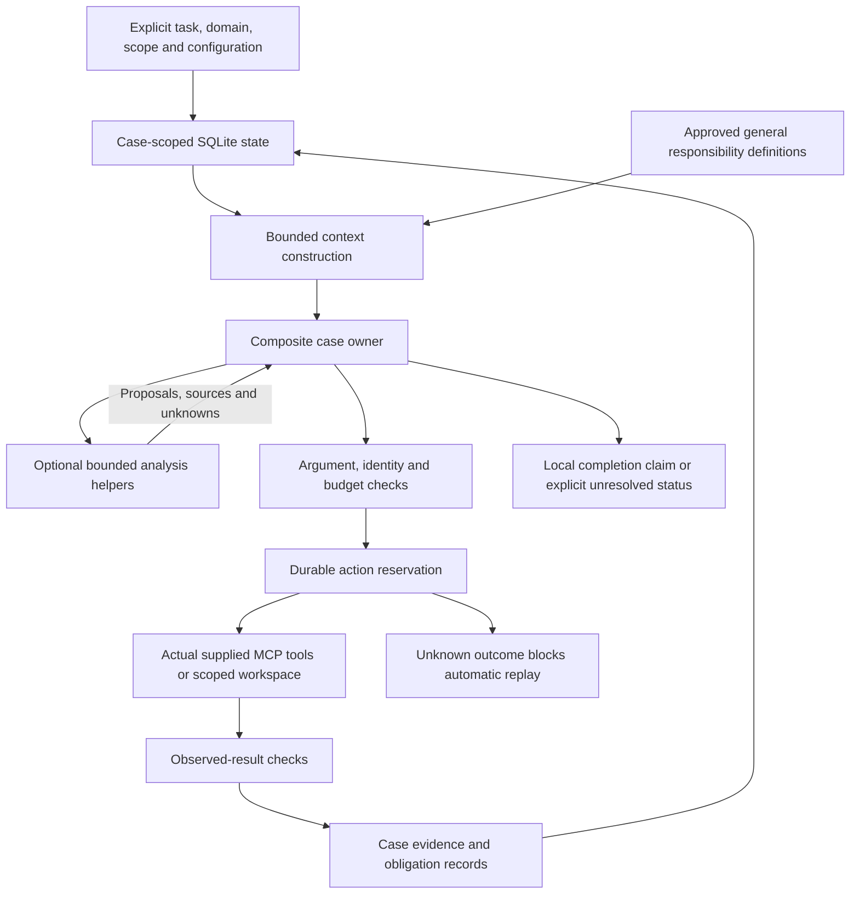

# Runtime architecture and design boundaries

The first implementation is a Python package with a standard-library core. It organizes supplied PA, UM and CM work; it does not reproduce hospital physiology, replace χ-Bench world state, or invent external participants. [The blueprint](../HealthHarnessBlueprint/README.md) remains the broader design reference; implemented behavior and executed checks are recorded separately in [verification](VERIFICATION.md).

## State and ownership

The namespace includes environment, task, organization, principal, patient and case. Canonical encoding determines a stable scope key. Database state and action queries use that key. Reusing a Python process does not entitle it to assemble another case's conversation or evidence into the current request.

SQLite transactions provide local atomic updates, optimistic state versions and lease fencing. The action journal records intent before an external effect. A process can fail after the remote server acts but before the result is durably recorded. That outcome is uncertain; this package must block automatic mutation replay rather than promise exactly-once delivery. Remote idempotency/transaction guarantees are separate contracts.

Case records hold messages, obligations, attributed tool observations and persisted budgets. Model-generated prose, helper proposals and locally authored artifacts are interpretations or outputs, not independently observed clinical truth. Local source IDs establish where support came from; they cannot mathematically prove that a free-form medical conclusion follows from the source.

This is a trusted local application boundary. Namespace checks do not constitute authentication against arbitrary code with database/file access. Filesystem permissions, encryption, multi-tenant services and real healthcare deployment controls are separate work.

## Responsibility composition

The packaged 66 design contracts are reusable general instructions. They remain detached from patient-derived memory. They are not 66 deployed workers or proof of 66 implemented clinical capabilities.

The combined owner performs relevant responsibilities itself. Helper arrangements use bounded, tool-free inferences over selected same-case observations; the owner retains operation authority and merges proposals explicitly. A larger team is an experimental composition of selected responsibilities, not a second simulated payer or patient. Compare actual quality and cost before adding workers. These arrangements have no established benchmark advantage.

## Providers and context

The model adapter makes explicit stateless Chat Completions requests. No persistent provider thread is reassigned across patients. The server may retain prompts under its own policy; this implementation does not prove provider-side deletion, training exclusion or isolation.

Call and context bounds are local resource controls. A character budget is not an exact tokenizer or dollar budget, and provider compatibility depends on the configured endpoint/model. Source records and open obligations must survive a stopped or reduced context; reduction must not turn missing information into inferred completion. Runtime credentials are read from a configured environment variable only during an explicit live invocation.

## Tools and environment trust

The MCP transport uses discovered names and schemas. Unknown purity is treated conservatively; an annotation is a hint, not a grant of clinical or organizational authority. The actual task server remains responsible for the dataset/principal access it exposes. Schema validation and known identity fields reject concrete mistakes but cannot establish ownership of every opaque document, referral or session ID without a verified binding.

Allowlisted reference reads are distinct from writable case artifacts. No general shell or arbitrary host-filesystem tool is part of the package. Working roots must remain case-scoped; external reference roots must contain only material approved for this job. A malicious local process changing a symlink concurrently is outside a pure path-resolution sandbox's guarantees.

The implementation must not inspect verifier/expectation/solution files or import them as acting context. Supporting handbook/tool references are runtime inputs, not tracked package content. Never publish a private runtime image containing the handbook.

## Integration limits

[The pinned integration map](CHI_BENCH_MAPPING.md) documents the actual actor surfaces and runner dispatch. The optional Harbor adapter is a packaging/launch bridge. Its presence does not mean a real Docker trial, provider call, conversation simulator, official judge or submission has run. Explicit patient/case configuration remains a precondition until a separately tested discovery/binding flow exists.
