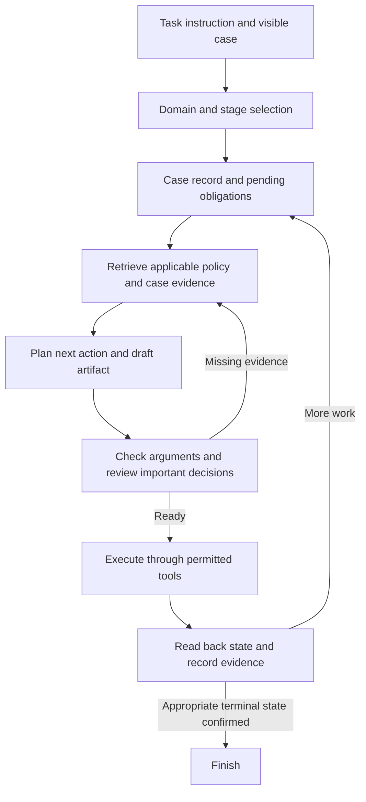

# Approach ideas for χ-Bench

Prepared October 13, 2026. This is a set of proposals and an experimental plan, not an approved architecture or tested solution. No benchmark runs or API spending have occurred.

October 15 steering: the user wants background due diligence before agent creation. Start with [BACKGROUND_BRIEF.md](BACKGROUND_BRIEF.md); these ideas remain unselected hypotheses. Earlier literature references use v1; the background review uses v3.

## Recommendation

Start with a strong existing harness as the baseline. Build toward a case-management agent with explicit workflow state, evidence-linked decisions, and a bounded review before important actions. Use one component to execute state-changing tools so the case has a consistent owner.

The central hypothesis is that tracking obligations and validating the next action will improve complete-case success and repeatability. The official scorecard uses strict binary scoring: a nearly complete case can still fail. [Scorecard documentation](https://www.actava.ai/benchmarks/docs/scorecard)

The paper reports reasoning, workflow completion, and policy errors, plus conversation-specific problems in care management. These observations motivate the experiments below; they do not establish that our proposed additions will work. [Paper, sections 4.5–4.7](https://arxiv.org/html/2605.16679v1)

## 1. Workflow controller with explicit completion checks

Maintain a structured case record containing current stage, patient/case identifiers, acquired evidence, applicable obligations, completed actions, unresolved questions, and the next permitted action. Generate obligations from the task instruction, approved handbook, and documented tool contracts.

At each stage, ask what must be true before advancing, what action changes the world, and how that change can be observed afterward. Validate structured arguments before sending them. Read back the case after important writes; a successful tool response alone is insufficient evidence of completion.

Use flexible branching: different starting stages, missing evidence, requests for information, or ineligible cases can require different paths. Do not force every case through the same universal checklist. The public architecture documents an example where failed eligibility ends processing at intake rather than requiring clinical review. [Architecture documentation](https://github.com/actava-ai/chi-bench/blob/main/docs/architecture.md)

Keep uncertainty explicit. If evidence is missing, follow the policy-supported next action rather than inventing evidence or looping indefinitely. Give clarification/review loops a fixed budget and reserve time for required final actions. Recheck state before retrying a write to avoid duplicate operations.

Expected benefit: fewer omitted steps and more verified terminal actions. Risk: an overly rigid controller can block valid exceptions or consume the time budget. Test completion gains alongside new abstentions and timeouts.

## 2. Policy retrieval that produces an evidence table

Once handbook access is approved, search by domain, workflow role, payer/plan, requested service, and policy identifiers. Start with headings and keyword search; add semantic search and reranking only if retrieval failures justify them. Preserve document identity, section, and applicable version with each retrieved passage. Derived handbook indexes should stay in the permitted local environment and follow the handbook license.

For each relevant criterion, store:

| Criterion | Evidence | Assessment | Next step |
| --- | --- | --- | --- |
| Requirement from an applicable policy | Specific chart, tool response, or dialog source | Met / not met / unknown | Obtain evidence, proceed, or follow the applicable exception |

Represent AND/OR conditions, thresholds, dates, prerequisites, exclusions, and exceptions explicitly. Distinguish an absent record from an explicit negative finding. A stronger variant converts the policy into a small criterion graph, then checks the graph against case evidence. Any automated conversion must remain traceable to the original policy and be checked for fidelity.

Expected benefit: decisions and artifacts become auditable and less prone to unsupported conclusions. Risk: retrieving the wrong policy or mistranslating a condition can create confident errors. Test retrieval relevance separately from policy interpretation and decision accuracy.

## 3. Independent review before an irreversible action

Have the executor propose the decision, supporting evidence, draft artifact, and intended next action. A separate review call checks policy applicability, logical conditions, contradictions, missing evidence, and readiness to advance. Review uses agent-visible information only and is not the official benchmark verifier.

First try a fresh review context with the same model. Test a different reviewer model only if the extra cost produces repeatable improvements. Invoke review at meaningful decisions and finalization, rather than after every harmless read. Limit revisions and resolve disagreements using evidence and applicable policy, not a majority vote over unsupported answers.

Expected benefit: catches mistakes before they become persisted decisions. Risk: correlated errors, extra latency, and reviewers that repeatedly prevent appropriate progress. Measure corrected errors, introduced errors, added cost, and completion rate.

## 4. Domain and role-specific operating procedures

Use a shared case record and tool execution layer with different prompts and procedures for each domain. Role changes should transfer a concise evidence-backed record; they need not require separate autonomous agents.

| Domain | Proposed emphasis |
| --- | --- |
| Provider prior authorization | Identify the requested service, assemble a supported packet, submit, and respond to the observed payer workflow when needed |
| Payer utilization management | Establish administrative eligibility, interpret applicable policy, route through required reviews, and issue a supported determination |
| Care management | Drive outreach and assessment, preserve actual patient responses and consent, and complete the appropriate care-management disposition |

The task explorer confirms three domains with 25 agent-facing task instructions each. [Official task explorer](https://www.actava.ai/benchmarks/tasks)

A possible later extension uses specialist reasoning calls for policy, case evidence, or artifacts, with one executor owning all writes. First establish whether role-specific prompts alone help; additional agents add coordination and cost.

Expected benefit: more focused decisions with less irrelevant context. Risk: information loss at role handoffs. Check source provenance and unresolved obligations whenever context is refreshed.

## 5. A dedicated conversation controller

Treat simulated patient outreach and physician discussion as their own workflows. Track questions already asked, explicit answers, unknowns, consent/refusal, and what must happen next. Choose the next question from missing information instead of repeating a fixed script.

Keep chart evidence and patient statements distinct. Resolve contradictions through permitted questions or policy-directed actions. Do not infer assessment answers from silence or manufacture consent. If a patient declines, follow the permitted disposition rather than repeatedly broadening or reframing the offer to obtain agreement. Avoid duplicate questions after context compaction.

Expected benefit: more complete and internally consistent assessments and conversations. Risk: long dialogs that leave too little time for documentation or finalization. Measure both dialog quality and downstream completion; a good conversation alone is insufficient.

## 6. Improve from failure categories, preserving generalization

Inspect official outputs after development runs to categorize failures: environment/harness, tool arguments, retrieval, policy interpretation, reasoning, conversation, missing artifacts, missing terminal actions, or timeout. Keep post-run scorecards outside the acting agent's inputs. Do not read hidden expectations, private solutions, or verifier-only task files to construct solutions.

Prioritize changes that recover complete failed tasks. A rise in partial-check completion without more binary passes is diagnostic progress, not a competition-score gain. Extract general procedures from legal development feedback rather than task-ID answers or patient-specific scripts.

Reserve a stratified public subset before tuning. Hold out whole workflow families where practical to test transfer beyond near-duplicate cases. Once the reserved set is used to select a configuration, record that it is no longer an untouched validation set. Private evaluation remains the decisive generalization test.

## Proposed architecture

The case record is working memory derived from allowed observations. It does not hold private expected answers. Completion checks are our own checks derived from visible requirements, not calls to the hidden verifier during a task.

The official extension guide supports both alternate models and a custom agent loop. Reuse the provided integration rather than replacing the simulator, judge, or official scoring. [Extension guide](https://github.com/actava-ai/chi-bench/blob/main/docs/extending.md)

## Development sequence and meaningful experiments

1. Resolve handbook access, full Rules, budget, and supported current model endpoints. Pin runtime commit, dataset release, simulator/judge configuration, and dependencies. Verify setup and smoke-test one task per domain.
2. Choose roughly 12 varied development tasks, four per domain, and reserve a separate stratified validation subset. Compare one or two existing model/harness configurations on the same task set. This is screening, not a reliable ranking estimate.
3. Add the case record and completion checks first. Compare against the unchanged baseline using the same tasks, model, configuration, and attempt policy. Retain the change only if complete-task results improve without unacceptable regressions.
4. Add evidence-linked policy retrieval, then decision review, as separate experiments. Do not combine all additions at once; otherwise their effects cannot be distinguished.
5. Add the conversation controller and role procedures where recorded failures justify them. Re-run comparable tasks in fresh environments.
6. Freeze a candidate and evaluate the reserved set. Report task counts, per-domain results, and uncertainty; small score differences may be noise.
7. Run the complete 75-task public set. Repeat in three fresh attempts when the development budget permits. Report pass@1 and the proportion of tasks passing all three attempts; passing at least once is a different metric. Preserve the predetermined attempt policy rather than selecting the best attempt per task.
8. Freeze code/prompts/configuration, prepare reproducible evidence and cost records, and test the final runnable package from a clean environment. Keep the Kaggle task-reward CSV separate from the benchmark evidence packet's aggregate CSV.

Budget for agent calls, independent reviews, simulated conversations, and official judging. Measure their costs in the pilot before projecting a full experiment. Optimize cost and tool calls after obtaining reliable success improvements, since the supplied ranking puts them after pass@1 and pass^3.

## What I would defer

- Training a new model before establishing where an existing strong model fails. Fine-tuning may later help narrow skills, but 75 public cases give limited coverage and carry overfitting risk.
- Large multi-agent teams, broad branching search, or ensembles for every step. Test a bounded reviewer first; exploratory writes cannot be assumed reversible.
- Starting with a large vector database or knowledge graph before simple retrieval is measured. The criterion graph is an optional targeted representation, not a required infrastructure project.
- Running all cases in one shared conversation. Use fresh per-trial case state and keep development feedback outside evaluation-time state.
- Optimizing the cheapest model first. Establish whether workflow structure helps, then evaluate cheaper extraction/retrieval calls or selective routing while retaining strong reasoning where it matters.
- Writing an elaborate frontend. The immediate artifact is a runnable agent and valid evidence, not a product demonstration.

## Decision status and next steps

Recommended first experiment: baseline versus baseline plus structured case memory and completion checks. Recommended research theme for a report: evidence-linked workflow control with bounded review for reliable healthcare administration.

These are hypotheses and recommendations. User decisions remain open: budget, model providers, team capacity, handbook approval, and implementation depth. No approach has been selected or tested. Full competition Rules and final package/report timing still require confirmation; benchmark documentation is not a substitute for competition Rules.

See [official research notes](Source/02-official-research-notes.md) for source receipts and verification limits, and [source summary](Source/SUMMARY.md) for the supplied competition requirements.
