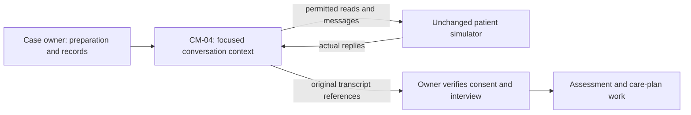

# CM completion repair: research, decisions and execution plan

**Current November 3 restriction:** documentation only. Implementation and
execution must not resume without a new instruction. The latest verified code
is `d77870c`; six runtime-guard source files now have unfinished, untested edits.
Read [the current state and -21 incident](CM_RUNTIME_FAILURE_20261101.md).

October 27, 2026. Root owns research, coding and integration. The user explicitly
resumed work, requested deep research and autonomous decisions, and made completion
of the existing CM task the goal. No paid judge or full-dataset run is authorized.

## Required result and boundaries

Execute the same case to a source-grounded assessment and finalized care plan,
then obtain all applicable native key-free checks passing on its saved export.
Software tests, improved engagement, a supported refusal and a normal process exit
are not substitutes. Semantic judging remains unmeasured without authorization.
Do not change the patient, scoring, task, consent evidence or official environment.
Root previously inspected private patient instructions at the user's request;
subsequent same-case work is assisted development. Do not inject that narrative,
its private conditions or assessment answers into the worker. No further private
persona/expected-value/solution inspection is part of this plan.

## Research and applicability

The following are external design references, not governing benchmark policy.
The worker must still retrieve the applicable permitted handbook and tool contracts.

1. [AHRQ shared decision-making implementation guide](https://www.ahrq.gov/health-literacy/professional-training/shared-decision/tool/resource-8.html)
   describes participation, discussion of options, patient preferences, a joint
   decision and review. Applied here: empathy must support a meaningful choice
   about an available next step. It does not mean repeatedly offering to stop
   instead of explaining help, or obtaining agreement through pressure.
2. [AHRQ communication strategy](https://www.ahrq.gov/cahps/quality-improvement/improvement-guide/6-strategies-for-improving/communication/strategy6i-shared-decisionmaking.html)
   connects evidence about options with patient goals and preferences. Applied
   here: the worker should distinguish recorded clinical information from what
   the patient has confirmed, explain useful options and preserve uncertainty.
3. [SAMHSA TIP35, chapter 3](https://www.ncbi.nlm.nih.gov/books/NBK571068/)
   identifies open questions, affirmations, reflective listening and summaries;
   [chapter 6](https://www.ncbi.nlm.nih.gov/books/NBK571066/) discusses moving from
   preparation to planning. Applicability is limited: this is substance-use
   counseling guidance, not a CM enrollment script or condition-specific policy.
   Search-index excerpts were accessible; full chapters returned a browser check,
   and the SAMHSA advisory PDF returned403. No detailed unobserved clauses are
   treated as verified. AHRQ independently supports the implemented broad approach.
4. [Anthropic context engineering](https://www.anthropic.com/research/effective-context-engineering-for-ai-agents)
   recommends selective context, recoverable tool results, durable notes and
   bounded specialist work. Applied here: retain useful original passages and
   source pointers while avoiding repeated copies. This is engineering guidance,
   not evidence that a particular projection improves Luna or this benchmark.
5. [Lost in the Middle](https://arxiv.org/abs/2307.03172) reports position-sensitive
   retrieval performance on the studied models/tasks. It motivates testing
   information accessibility; it does not prove the cause of this run's reasoning
   failure or predict modern Luna performance.
6. [ReAct](https://arxiv.org/abs/2210.03629) studies interleaving plans, actions and
   observations. Applied here: a concise operational next step should respond to
   actual patient/tool feedback. No private reasoning trace is requested or stored.
7. [Building effective agents](https://www.anthropic.com/research/building-effective-agents)
   favors simple composable interfaces and observed environment feedback.
   Applied here: repair the existing owner/retrieval/verification interfaces
   rather than add a new multi-agent organization or compulsory clinical path.

## Confirmed local evidence

Run -10 used42 shared model calls/78 operations and2,384,107 reported workflow
tokens. Six patient replies; no consent, assessment or finalized plan. The worker
acknowledged the patient's agenda but replaced useful next steps with disclaimers
and repeated stopping offers. It claimed clinician follow-up information was
unavailable despite a previously returned chart document containing a plan;
that plan still required current-applicability checking.

The final stop report incorrectly cited its authored outreach summary as an
investigation. Source-type rejection was correct. The adapter only offered its
precise source correction when a structural endpoint was already accepted,
which this case lacked. Four generic recovery cycles followed. Their fingerprints
changed with procedural audits; the task still could not reach its goal after
the patient ended and the case was terminal. This mixed evidence-format repair,
clinical replanning and reporting of an unsuccessful execution.

## Decisions and ordered implementation

1. **Purposeful communication.** Balance listening with a specific source-supported
   offer of help and an informed participation decision. Check existing chart/tool
   information before claiming inability. Differentiate reviewing a recorded plan
   from contacting a clinician or delivering care. Preserve refusal/stop rights.
   No fixed dialogue script or hidden-persona conditions.
2. **Accessible case context.** Expose a bounded exact chart-document index with
   original pointers. Preserve short public operational plans, including the next
   step. Remove an exact duplicate tool-result body only when the identical source
   is already present in the retained reference view. Full originals stay in SQLite.
   No lossy clinical summarizer, extra model call or arbitrary hard context cap.
3. **Separate stop reporting from success.** Offer one precise tool-free reference
   correction regardless of whether clinical completion passed. An evidence-valid
   incomplete stop remains unsuccessful; it should not have to claim a supported
   successful endpoint to stop. Keep one bounded challenge to a premature stop,
   identity/provenance/unknown-write guards, and all native requirements.
4. **Verify before execution.** Synthetic varied evidence checks for chart-source
   accessibility, unchanged-source retention, plan continuity and failed stopping
   without a completion bypass. Run affected regressions and integrated suite.
   Reproject -10 offline to measure bytes; do not call that a clinical result.
5. **Execute and measure.** Commit/freeze source, fresh single-case -11 (or next
   unused suffix), Luna/high, helpers/auto, no patient cumulative quota, three
   repeated-exchange stop, existing actor100/500 and per-request deadlines. Preserve
   snapshots, perform native structural verification without paid judging, and
   inspect actual sources/effects. Iterate only against a new evidence-backed
   general cause; never force consent or populate fictional records for a score.

## Acceptance gates

| Gate | Evidence | Pass condition |
|---|---|---|
| General repair mechanics | Synthetic integration/regressions | Provenance/isolation intact; no success bypass |
| Useful evidence survives projection | Exact original-source replay | Old relevant document reachable; duplicate removal lossless |
| Conversation | Original transcript and actual outreach record | Consent accurately represented; patient boundaries preserved |
| Requested task result | Actual tool effects/export | Assessment and finalized source-grounded plan exist |
| Native evaluation | Official structural verifier on saved export | All applicable native checks pass |
| Honesty/reproducibility | Frozen source, receipts, Progress | Failed attempts separate; no official semantic claim |

Implementation and live outcomes will be appended as they occur. The plan itself
does not establish any of these gates as passed.

## Implemented and verified before retry -11

Root implemented the ordered repairs in `roles.py`, `assignment.py`,
`planning.py`, `retrieval.py`, `working_set.py`, `closure.py` and `engine.py`.
Document indexing contains original metadata/pointers only. Public plan summaries
remain worker interpretations; source links are checked against the active case.
Duplicate clearing requires equality of the entire business result already
retained in context, and preserves original storage/raw access.

The stop repair additionally preserves source-linked blocked-work IDs even when
endpoint verification fails, and supplies exact saved deferred/blocked IDs during
the bounded correction. It never closes those obligations or verifies that their
necessity is clinically correct. A regression caught an initial integrity-path
mistake: invalid contracts were offered a source correction. Invalid contract,
identity and validator assessment now reject finalization before any correction.

Final integrated regression: **720 tests pass / 61.580s**. New cases include the
complete owner loop correcting one failed-stop citation without restarting the
workflow, failed endpoint with still-open blocked work, source-index accessibility,
plan continuity and unchanged originals. Private release log:
`HealthHarnessCodex/runs/20261027-cm-research-release-regression.log`.

Offline replay on -10's final saved state: 98,142 ->97,820 serialized message
characters (**0.33% lower**), same messages, no tool schemas, no model call.
This is not a live token-saving result. Its limited effect at this state is
disclosed; no artificial size-reduction target was used. Correcting source and
work-accounting metadata in a diagnostic copy validates the unsuccessful stop
while the clinical endpoint remains rejected. Snapshot hash unchanged. Receipt:
`HealthHarnessCodex/runs/20261027-cm-offline-replay.json`.

Native structural evaluation of the original unchanged -10 snapshot is now
actually executed: **2/6 pass, 4 fail, 8 N/A**, same four check names as -08.
No semantic judge, credentials or network. Private summary under
`HealthHarnessCodex/runs/20261026-random-cm-anorexia-10-structural-only/`.
This does not establish any improvement in the CM outcome. Root commits/freezes
source before fresh same-case -11, with Luna/high helpers/auto,actor100/500,
patient cumulative quotas0, no paid judge and no private persona in actor context.

## Attempt -11: measured failure and next general revision

Source `cb64466`;32 owner/helper calls,42 operations,7 patient calls;
1,546,802 reported workflow tokens (1,523,281 input +23,521 output;323,328
cached input included). No generic workflow recovery cycle, one helper job.
Snapshot saved/world stopped. Native structural **2/6 pass,4 fail,8 N/A**;
same assessment/plan/status/audit failures. No paid judge. The last incomplete
report still explicitly included an authored outreach summary as an investigation
despite its source-only correction, so it exited with
`stop_report_reference_repair_exhausted`. This was correctly not relabeled success.
Fewer calls/tokens than -10 are descriptive only: trajectories differ, not a
controlled performance estimate. The clinical goal is still unmet.

The original transcript shows program explanations repeatedly followed by yes/no
enrollment invitations. The worker answered more questions, but did not explore
the patient's ambivalence through reflective open questions. This motivates a
specific general skill change, rather than another task-specific response rule.

Further accessible primary guidance:
[Pennsylvania Department of Health training, pages109–110 of the PDF](https://www.pa.gov/content/dam/copapwp-pagov/en/health/documents/topics/documents/programs/pdmp/Evidence_Based_Prescribing_Tools.pdf#page=109).
The published communication component describes collaboration/autonomy, open
questions, affirmations, reflections and summaries, with engagement, focus,
elicitation of the person's motivation, and planning. Its prescribing/SUD setting
does not govern this benchmark; only the general communication method is adopted.
Unlike the blocked SAMHSA full text, these pages were actually accessible.

Revision: explicitly describe that flexible motivational-interviewing method in
the CM role, with permission/policy boundaries and no clinical screening before
consent. No specific patient concerns, labels, hidden disclosure facts or consent
conditions are encoded. The model performs the assigned RN care-manager role in
the task environment and chooses its own questions and actions.

Mechanical revision: final stop records may omit the factual completed-investigation
list. Code derives ONLY that omitted list from the actual scoped journal,
keeping the submitted model report and derivation receipt. It
does not rewrite reasons, patient choices, clinical decisions or explicit invalid
lists. Blocked/deferred work still needs explicit owner acknowledgement. The
automatically derived list records performed operations, not reasoning adequacy. This
removes unnecessary model bookkeeping while preserving provenance rejection and
the independent clinical completion gate. A regression caught an overly broad
first version deriving blocked-work acknowledgement; it was narrowed rather
than weakening that existing test. **722 tests pass /63.453s** after narrowing;
release log `HealthHarnessCodex/runs/20261027-cm-engagement-release-regression.log`.
The tests retain explicit invalid-list rejection and failed-goal classification.
Root commits/freezes then executes fresh -12 under the same existing authorization.

## Attempt -12 and scoped conversation-worker implementation

Source `0c93765`;26 owner/helper calls,35 operations,8 patient calls;
1,191,055 reported workflow tokens (1,172,953 input +18,102 output;275,712
cached input included). The patient identified useful coordination and contact
preferences but declined broader enrollment. No assessment/finalized plan.
Native structural **2/6 pass,4 fail,8 N/A**; no semantic judge. Snapshot/world
stop preserved. A later explicit final-report citation still failed its bounded
repair; the prior derivation marker remained in state. The new code clears that
marker before each new final so a previous derivation is not attributed to an
explicit later report. No clinical result is relabeled.

The generic interviewing guidance elicited more practical needs, but the owner
still carried administration, tools, evidence and dialogue in one context. The
next hypothesis is responsibility/context separation using the already defined
CM-04 Conversation turn coordinator, rather than another private patient recipe.
This follows the composable routing/specialization principles of the engineering
sources above; it is a hypothesis awaiting execution evidence.

Implemented `dialogue_worker.py`: in helpers/team with auto policy, the first
send proposal after an observed active CM session starts one explicitly scoped
CM-04 job. The owner draft is not sent. The model receives a small observed source
set plus selected reads and only one write operation: patient messaging. It can
retrieve other permitted evidence, conduct an informed-consent conversation and,
after actual consent/permissions, gather the interview information needed by the
public assignment. It cannot persist assessment/plan/closure or use private
persona data. All model/tool operations use the same case budgets and dispatcher.
There is no added fixed conversation count; its job budget is the remaining
shared model allowance minus owner integration reserve. Patient model unchanged.

Verified public service contract: `end_outreach_call` ends the live session;
`start_assessment` requires the subsequent persisted state. Accordingly, interview
needs must be considered while the channel is still open, not confused with the
timing of structured persistence. The worker/owner must still establish actual
consent and policy applicability; tool availability never grants permission.

The worker's original dialogue/effects are retained, and its conclusion remains
advice rather than evidence. A new owner turn verifies the transcript and handles
structured records. Stale siblings from before the delegation are not dispatched.
An interrupted/uncertain worker cannot be restarted silently. Combined/other
domains keep their original path. The packaged CM-04 status now honestly records
this implementation; the original harness/research catalogue is untouched.

Verification: **725 integrated tests pass /65.104s**; additional focused dialogue
and responsibility checks pass after final wording changes. New tests exercise
real helper dispatch, restricted tools, unsent owner draft, stale-write fencing,
new owner-turn write availability, uncertain-effect nonrestart, and combined/UM
nonactivation. No scored improvement claimed. Root commits/freezes then attempts
fresh same-case -13; no paid judge/all75/private persona injection.

## Attempt -13 and independent actor/patient model selection

Source `3fd9b0e`;42 shared model calls,59 operations,4 patient-model calls;
2,124,695 reported workflow tokens (2,094,523 input +30,172 output;741,632
cached input included). CM-04 actually ran but returned incomplete after20 model
calls. No enrollment/assessment/plan; final source-backed incomplete stop was
accepted as unsuccessful. Snapshot/world stop preserved. Native **2/6 pass,
4 fail,8 N/A**, no paid judge. Context specialization is implemented and tested,
but this trial did not demonstrate improved CM completion or token efficiency.

Autonomous decision: escalate the case worker to GPT-6.1 Sol/high for the next
attempt while keeping the experimental patient fixed at Luna/high. Repeated
Luna failures do not prove an absolute model limitation, and a stronger-model
success would not prove the harness changes alone caused it. The purpose is to
obtain a valid execution with the repaired interfaces and report the exact
configuration rather than keep adding outcome-specific rules.

Found and removed a harness-only validation coupling requiring the actor and
patient to have the same model. The simulator worker already independently pins
its backend model; main-model selection must not implicitly change the patient.
The default actor remains Luna. Each selection stays separately frozen in the
manifest, and the experimental simulator still forbids provider credentials/
benchmark egress and requires deferred grading. No paid-judge change. Existing
Codex sign-in is used; different account usage is expected and must be disclosed.

Verification: all38 affected batch tests pass/22.105s, including a frozen
configuration with actor6.1 and patientLuna/high. The previous725 integrated
tests remain the last full-suite result; no full-suite claim is made for the
subsequent small selection change. A readonly native probe initialized and
authenticated with model_configured6.1; it made no inference call and does not
itself prove generation or clinical capability. Root commits/freezes before
fresh -14 with explicit `--model gpt-6.1-sol`. Patient/benchmark unchanged.

### Model-selection path repair before actual -14

The first -14 command was rejected by argument parsing: the CLI had no model
option. No case world, manifest or inference started. Tracing further found the
standalone native constructor and its report/recorder metadata also hardcoded
Luna. Those are now parameterized end to end: CLI -> BatchConfig -> run_case ->
identity episodes -> native constructor and all metadata. Standalone's own CLI
also exposes the option; default behavior stays Luna/high.

New integration tests spy on the actual standalone constructor and recorded
model, not merely the argument parser/frozen label. Batch forwarding is checked
against the real runner callback. Full release **728 tests pass /71.568s**;
private log `HealthHarnessCodex/runs/20261027-model-selection-release-regression.log`.
An exact real-task `--plan-only` command now selects one CM case, actor6.1 and
patientLuna, with no inference/Docker execution. Receipt:
`HealthHarnessCodex/runs/20261027-actor14-plan.private.json`. Root commits/freezes
then launches actual -14; do not count the rejected CLI command as an actor trial.

## October 28 continuation: actual -14 result and clinical leadership

Actual -14 on `3b117c0` stopped at call8 with provider failure category
`error:unknown:usageLimitExceeded`, before outreach. 8 model calls/16 operations,
0 patient calls;255,966 reported tokens (251,273 input +4,693 output). Snapshot
saved/world stopped. It did not test the stronger model's conversation, and no
native or paid grading was run. Do not attribute this result to refusal or clinical
reasoning. Current account readback allows usage again; user explicitly resumed.

The user asked who leads and emphasized making the value of help credible.
Clarified role division: case owner leads overall execution; CM-04 guides the
clinical conversation; the patient controls participation, goals and boundaries.
Guidance connects the person's concern to a supported next step, explains the
improvement it may offer and calls for follow-through. Enrollment is an informed
decision within that work, not a substitute for useful care coordination.

Also corrected a prompt contradiction: the delegated worker was asked to gather
permitted post-consent interview information but later told not to "perform
assessment." That restriction now explicitly concerns structured record writes.
Permissions and consent requirements remain; the owner retains persistence and
verification. No private persona material or guarantees added. 13 focused dialogue/
responsibility checks pass after these wording changes;728 remains last integrated
suite result. Dialogue-question construction remains below its4000-character bound.

Docker was stopped and has been started; Linux engine confirmed ready. Commit/
freeze then fresh same-case `20261028-random-cm-anorexia-15`, actor6.1/high and
patientLuna/high unchanged,helpers/auto,100/500,no patient cumulative quotas,
no paidjudge. The task is still not complete; a valid actual assessment/plan and
passing native checks are required before declaring the objective achieved.

## Attempt -15: confirmed interface/source failures before outreach

Run `20261028-random-cm-anorexia-15`, source `d55e8c8`:9 model calls/22
operations,0 patient calls. Root actually stopped the owned inference process
while its ninth reply was streaming. It is an operator-interrupted development
trial, not a natural clinical failure or another quota failure. Snapshot saved
and world stopped. No partial proposal from call9 executed. No native/paid judge.

Private capture proves49,622 public assistant-output characters;48,829 were
insignificant spaces/tabs after a JSON integer in a proposed grouped file read.
The numeric schema allowed the value; this capture does not prove a contradictory
schema or a particular upstream cause. The old exact-period repetition detector
missed varying whitespace. Added a JSON-aware streaming check for512 consecutive
outside-string whitespace characters. String/escape state spans chunks and resets
per item/request; quoted text formatting and normal indentation remain valid.
The `response_whitespace` category requests one existing budgeted compact-response
correction, with no partial execution. This is not a context or dialogue quota.

Also confirmed a separate harness defect: correct source pointers into approved
CM eligibility/risk/outreach workflow files were rejected when recording an
intake decision. `allow_workflow` depended only on disenrollment. It now recognizes
the CM operation families. It still rejects metadata, authored drafts and chart
opinions as policy; a CM workflow source still cannot substitute for provider
coverage policy. Policy applicability/interpretation remain model judgments.
This removes a false source gate; it does not choose program, priority or outcome.

Verification: **731 integrated tests pass /176.203s**, including variable mixed
whitespace, escaped long text, direct/batched CM workflow citations and preserved
provider-source restrictions. Log `runs/20261028-whitespace-cm-policy-regression.log`.
A real patient-free6.1/high protocol test with the same nested grouped-reader
schema and numeric offset returned a finite correct proposal in12.14s,7,316
reported tokens; no tool executed or patient data supplied. It establishes one
successful interface sample, not clinical performance or universal reliability.
Receipt `runs/20261028-synthetic-reader-protocol/result.json`.

Root commits/freezes before fresh same-case -16 with actor6.1/high and unchanged
Luna/high patient,helpers/auto,100/500,patientquotas0,no paid judge. No private
persona or outcome-specific answer is added. The clinical goal remains unmet.

## Attempt -16: recurring native JSON generation failure and recovery

Run `20261028-random-cm-anorexia-16`, source `eebb127`, ended naturally with
8 actor model calls and14 operations, before any patient conversation. Calls4,
7 and8 emitted long runs of whitespace while constructing grouped file-read
arguments. The receiver stopped each malformed reply; the last format correction
exhausted its allowed retry. No partial request executed. Snapshot saved and world
stopped. This is a response-generation failure, not patient refusal, an assessment
result or a benchmark verdict. No native or paid evaluation was run.

Repeating the same constrained decoding path did not resolve it. Recovery now
switches subsequent actor completions to ordinary JSON generation after the
specific `response_whitespace` signal. Original complete tool contracts remain
in the input; code parses the envelope and applies the original argument schemas
before dispatch. This changes how proposals are generated, not what operations
are authorized. Native commands, network access and other action channels remain
disabled. Each generation still consumes the shared budget. New cases start with
the original schema mode, and patient requests without tools do not switch.

A simpler native schema with arbitrary argument objects was tested and rejected
by the upstream API's strict-schema requirements. That prototype never ran on a
dataset actor. Omitting `outputSchema` instead completed an actual patient-free
native probe with all38 tool contracts declared:12.0 seconds,15,516 reported
tokens, one correctly formed grouped-read proposal. The original reader argument
validator accepted it. No tool executed and no patient records or persona were
supplied. Receipt: `runs/20261028-synthetic-host-decoder/plain-result.json`.

An integration regression also passes a malformed recovery-mode argument object
through the real harness: it is rejected before the remote tool can execute.
Native-action rejection is exercised in both decoding modes. Full release
regression completed: **732 tests passed** (runner reported5461.002 seconds).
Log: `runs/20261028-host-decoder-release-regression-02.log`. The first process
ended without a summary; its unfinished log is not a passing suite. Commit and
freeze the completed repair before a fresh same-case -17. Actual CM completion
remains unachieved.

## Attempt -17 setup and -18 native disconnection

Attempt -17 on `83e475a` failed during world startup because the Docker Linux
engine was offline. Zero inference, no patient call or saved case snapshot.
Docker Desktop was started hidden; Linux engine readiness was verified before a
fresh -18 on the same frozen source. This was not a clinical execution failure.

Attempt -18 ran5 actor calls/14 operations,0 patient calls, and ended naturally
on `error:unknown:responseStreamDisconnected`. Call5 returned no assistant reply
or proposals. Snapshot saved/world stopped. The whitespace recovery was not
activated: calls1–4 completed in the original schema mode. No native or paid
evaluation was run; no assessment or plan was produced.

Confirmed harness weakness: it retained safe transient-error metadata but never
used it for bounded recovery. The owner and delegated-worker loops now permit
one fresh generation after this specific classified disconnection, only when
the native process confirms cleanup, no proposal dispatched, no timeout occurred,
and the relevant shared/job budget remains. The next request uses successful
observations already stored; it does not replay tool calls. A second consecutive
disconnection stops. A valid subsequent model reply resets that consecutive
retry allowance. Quota/authentication failures, unknown errors and uncertain tool
writes do not qualify. Audit records retain failed/retry model-call numbers and
helper ownership. Logs expose `MODEL_RETRY` and evaluation records the count.

Focused regressions passed:47 engine tests and15 delegation tests, including
one-time saved-write execution, shared/helper budget accounting, repeated failure,
unconfirmed cleanup and exhausted-budget refusal. Full release regression:
**735 tests passed /80.092 seconds**; log
`runs/20261028-disconnection-release-regression.log`. Commit/freeze before fresh
same-case -19; no patient changes or paid judge.

## Attempt -19 result and next general repair

Source `0f926fd`,50 workflow calls/81 operations/6 patient replies;1,725,634
reported workflowtokens (1,692,949 input +32,685 output;48,640 cached input is
included). Call4 whitespace failure recovered atcall5 in host_validated mode;
subsequent generations completed. No disconnection/transport retry. Source/HEAD
stayed frozen. Actor1423.0seconds,world1469.3seconds. Snapshot saved/world stopped.

The conversation gave useful clinician-call preparation, but framed ongoing
support versus making that call independently as alternatives. The patient chose
the latter and explicitly declined enrollment. This wording is observed; it does
not prove the sole cause of refusal. No consent, assessment or finalized plan.
Official native key-free diagnostic:2/6 applicable pass,4fail,8N/A,binary0,
fractional1/3. Failed names are assessment record,care-plan record,target status,
cross-stage audit actions. No semantic/paid judge. Attempt remains unsuccessful.

Final unsuccessful-stop accounting also failed `stop_dependencies_not_accounted_for`
after one bounded correction; the generic error text incorrectly suggests all
such failures are source-reference errors. Diagnose the exact dependency mismatch,
preserve the truthful unfinished goal and do not relax native checks.

Confirmed delegation gap: the owner discovered assessment/care-plan operations,
but CM04 received only its own read/send tools plus selected sources. It had no
explicit metadata handoff describing the owner's downstream operations. This may
encourage understating the wider program as chat tips. A small generic team
capability/receipt map is being implemented, separate from callable permissions,
with scoped original source IDs and real tool descriptions; no extra clinical
facts or outcome-specific scripts. Clarify complementary support versus a false
exclusive choice. This is a plausible repair hypothesis, not proof it will obtain
consent. Test isolation and unchanged write boundaries before committing/rerunning.

External public research and local applicability audit are preserved in
[EXTERNAL_HARNESS_RESEARCH_20261028.md](EXTERNAL_HARNESS_RESEARCH_20261028.md).

## October 30: stage handoff and exact stop-record repair

The CM conversation worker now receives a small read-only team handoff: the actual
owner-only assessment/care-plan tool descriptions, original same-case intake/chart
receipt references, and the public requested work. No full chart or global
hospital graph is copied. Tools remain limited to the original delegated reads
and patient messaging. A regression attempts to execute an owner-only tool after
seeing its metadata and confirms it cannot dispatch. Foreign-case receipts are
excluded. The communication guidance explains what supported collaborative work
adds, without treating support and the patient's independent actions as mutually
exclusive, inventing delivery, withholding useful information or pressuring consent.

The -19 stop-record defect was field placement: correct explicit waiting/blocked
IDs were at the JSON top level, but the validator expected them nested inside
`stop_assessment`. Guidance now names the exact paths. Lossless relocation of
explicit worker fields is allowed and audited, never deriving acknowledgment from
the checker. Missing/wrong/conflicting IDs still fail; equivalent ID sets in a
different order do not create a conflict. Error reports distinguish accounting
from source-reference failures. Original submitted values are retained.

Offline replay of -19's actual final payload passes the repaired report validation
while the requested outcome remains **unmet**. No old snapshot was changed, no
tool ran and no native score was recomputed. Receipt:
`runs/20261028-stop-shape-replay.json`. This is not a newly successful trial.

Before the interruption739 integrated tests passed/60.797s. October30 source review
added the equivalent-order edge-case regression; fresh full release **740 tests
passed /222.671 seconds**. Log: `runs/20261030-stage-handoff-final-regression.log`.
Docker Linux engine is ready. An exact plan-only command selected the same one CM
case, actor6.1/high, patientLuna/high, helpers/auto,100/500, patient quotas0, no
context cap/no paid judge, with the current official Codex binary discovered in
place. No binary was copied or moved. Commit/freeze after release verification,
then fresh run `20261030-random-cm-anorexia-20`. Actual clinical goal remains unmet.

## November 1: actual -20 outcome and general repairs

User resumed after previously requesting a stop after this run. -20 source02ff467
ended naturally at46 workflow calls/82 operations,6 patient model calls. Call46
reported `error:unknown:usageLimitExceeded`, without a reply or proposal. This is
an account limit, not a new format error or timeout; no automatic quota retry ran.
Reported workflow usage1,959,146 tokens:1,933,379 input +25,767 output;42,240
cached input included. Actor1318.9seconds,world1364.0seconds. Snapshot saved/world
stopped. Native key-free2/6 pass,4fail,8N/A,binary0,fractional1/3. No paid judge.

The patient had declined before the quota error. No assessment or finalized plan
was produced. Thus the quota failure did not cause the missing consent earlier.
The six-capability handoff was actually delivered (2597characters, no extra write
rights), and the patient discussed preferences, but no enrollment resulted. This
is not clinical success. Final-report normalization was not reached before quota.

Two additional general gaps were confirmed. First, the helper did not get a
direct chart index although the owner had reviewed the chart. A small source-linked
index now exposes original document/field pointers, never copied bodies or private
persona material. Source scope/identity is checked; partial metadata is marked.
The role distinguishes permitted review of existing records from a new formal
assessment, which still needs consent. It must retrieve the governing protocol's
entry, ongoing and exit duties and plan for a counterparty ending contact in any
turn. Closing duties are performed only while communication remains permitted;
an actual stop remains final. No fixed patient-specific script or expected answer.

Second, progress history keyed only by tool name let alternating work/blocker reads
replace each other's results and look novel. It now tracks normalized query
arguments as well, while retaining legacy latest-tool summaries and same-content
duplicate feedback. Changed real results still count as new information. Replanning
remains a bounded advisory; code does not choose clinical disposition or forbid a
justified fresh read. All hashes/state remain inside the current case.

Focused verification:16 planning/recovery tests and7 dialogue tests passed;7 dialogue
tests passed after final wording clarification. Offline replay of -20 found5
unchanged working-record reads among10. Its new4151-character handoff included all6
original chart-document locations, metadata only, and the old snapshot hash stayed
unchanged. Receipt `runs/20261101-cm21-handoff-progress-replay.json`; no tools,
patient model or judge executed. The previous6/6 case goal remains unachieved.
First full743-test regression failed one existing artifact-tamper test, while it
passed in isolation. Its test now verifies the initial graded status, selected
output and complete artifact receipt before tampering. No integrity guard was
relaxed. The strengthened full release **743 tests passed /68.310s**; log
`runs/20261101-chart-handoff-progress-release-02.log`. The initial failure's cause
is unconfirmed; its log remains preserved, not overwritten or counted as passing.
Commit/freeze before freshsame-case `20261101-random-cm-anorexia-21`, actor6.1/high,
unchanged patientLuna/high,helpers/auto,100/500,patientquotas0,no paidjudge/all75.

## Attempt -21 and November 3 documentation checkpoint

The committed chart/progress repair `d77870c` actually ran as -21 on November 1.
Its world exited at22:01:22 IST with Docker exit255 and OOMKilled=false. The exit
cause is unknown. Generic container-operation errors were treated as recoverable
workspace failures, and the actor continued reading cached evidence. Root then
manually stopped the owned inference process; its final model error is therefore
operator-induced. Counters:16 workflow calls/30 operations/0 patient calls;
444,636 reported workflowtokens. No clinical conversation tested the new handoff.

The actor ended in error, deferred export failed, and the batch retained the world
as needs_reconciliation. There is no valid deferred snapshot or native/semantic
score for -21. The existing2/6 native result belongs to -20 only. Do not restart
or delete the retained world or reinterpret this as a patient refusal.

Partial runtime-guard work exists in six Python files but is uncommitted and
untested. Before further work, constructor compatibility, guard placement,
fatal-error propagation, unknown-write fencing and reporting require verification.
The November3 user request authorizes documentation only; this checkpoint does
not authorize implementation, tests, Docker operations or another case.
Full evidence locations and conditional next steps are in
[CM_RUNTIME_FAILURE_20261101.md](CM_RUNTIME_FAILURE_20261101.md).
