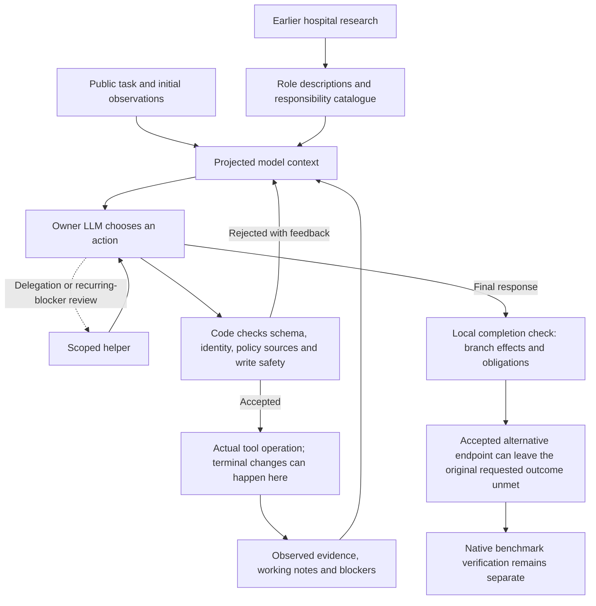
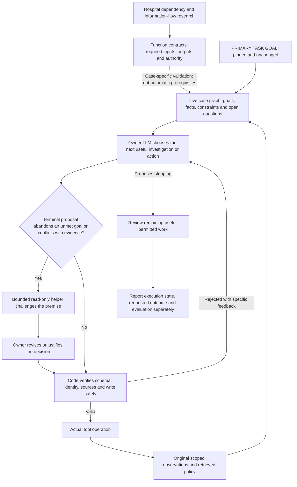
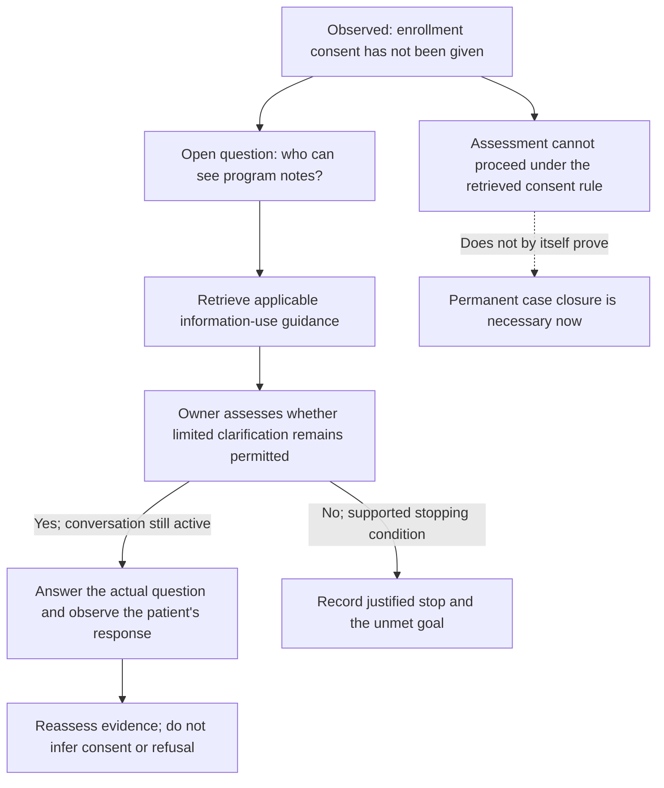

# Current and proposed execution — October 25

Historical comparison recorded before implementation. For the current targeted
implementation and its verification scope, see [goal-link implementation](GOAL_LINK_IMPLEMENTATION.md).

Current behavior below is implemented; the second flow is a proposal. This
explanation changes no actor behavior and launches no dataset task or judge.
The broader synthetic/model experiment matrix and PA/UM/CM evaluation plan are
on hold at the user's request. Existing CM -04 evidence remains unchanged.

## Current execution

This is a simplified control flow. Existing pre-dispatch policy/source checks
are included; the problem is not an absence of all guards or all working memory.



Current code has source-linked notes, blockers, policy decisions, helpers,
repetition feedback and closure checks. However, these are not one live graph
connecting the original goal to the consequences of the next action. In
`closure.py`, mandatory no-further-action review is keyed to external-wait
branches. An alternative terminal decline branch can pass the local gate
without that mandatory review. The original task is still in the context;
the gap is consistent operational use of its dependencies and goal impact.

## Proposed execution



The model still chooses tools and investigations. The graph is the model's
revisable account of dependencies; code does not preselect a fixed list of
clinical next moves. A helper challenges a consequential decision once per
materially unchanged state, shares the budget, and does not become the judge.
Its conclusion can be wrong. Actual outcomes and the original goal remain visible.

## Carrying the earlier research into execution

The earlier hospital study was intended to supply this dependency/data-flow
foundation. Implementation carried role descriptions and some boundaries into
the harness, but did not fully instantiate their information dependencies as
the execution-time case graph. That is the missing follow-through.

Relevant existing material:

- [Conditional dependency register](../Plan/HealthcareRoles/DEPENDENCIES.md).
- [Information-flow contracts](../Plan/HealthcareRoles/INFORMATION_FLOWS.md).
- [Proposed logical service contracts](../HealthHarnessBlueprint/SERVICE_CONTRACTS.md).
- [Proposed workflows](../HealthHarnessBlueprint/WORKFLOWS.md).
- Packaged role CM-12, care-task dependency planner, currently a proposed role
  definition in `HealthHarnessCodex/health_harness_codex/data/micro_roles.json`.

The hospital register marks its 219 edges as synthesized and not confirmed
institutional relationships. They can seed candidate information dependencies,
not become compulsory approvals or authority relationships. For each runtime
edge preserve source, applicability and epistemic status; validate tool availability
and task scope. This does not require one model for every person in the study.

## Keep the primary goal visible

Proposed compact markers:

```text
[PRIMARY TASK GOAL — KEEP VISIBLE] Requested care-plan outcome
[UNMET] Assessment and plan not yet performed
[BLOCKED] Assessment: clear enrollment consent absent
[OPEN QUESTION] Patient asks who can see program notes
[IRREVERSIBLE ACTION] Disenrollment closes the case
```

These indicate task importance and operational state, not medical urgency. The
original requested goal remains pinned across projections and helper handoffs;
its importance never overrides consent, evidence, policy or actual tool authority.

## Example: distinguish a blocked action from a blocked assignment

Illustrative earlier active-call state: the patient has not agreed to enroll
and asks how information will be shared. This is not a claim that the later
ended call may be resumed, or that the actual CM -04 endpoint was wrong.



Different claims need different support:

| Claim | Basis | What code can check |
| --- | --- | --- |
| A message request needs a session ID | Tool schema | Required field and scoped observed identifier |
| This session is active | Current tool response | Returned field and source; freshness where required |
| Assessment requires consent here | Model interpretation of retrieved policy | Exact cited source, not semantic correctness |
| Non-consent means permanent closure is required now | Separate model policy interpretation | Provenance and direct structured contradictions, not a universal inference |

The owner must inspect the complete relevant decline rule too. The policy
observed in CM -04 does provide a decline path after limited clarification
without consent. Thus this example is about evaluating the right condition at
the right time, not inventing an obligation to persuade indefinitely.

## Low ambiguity should produce straightforward execution

When inputs and requirements are clear, ordinary code should handle tracking IDs,
source pointers, known state transitions, duplicate detection and result formatting.
The model should not repeatedly reconstruct those mechanics. Most ordinary actions
need no second model call or formal alternatives essay.

Do not assume semantic ambiguity is always small. When it remains, identify the
specific unresolved question and its effect on the next decision. Added ceremony
is not evidence of better reasoning. The proposed review is selective.

## Status and decisions from the user's annotations

- Graphical current/proposed explanation requested and supplied here.
- Primary-goal importance markers accepted in principle; proposed labels above.
- Hospital dependencies/data flows must inform execution, not remain background
  role descriptions. Template-versus-case activation needs explicit agreement.
- Prerequisite categories require concrete examples rather than abstract labels.
- Clear cases should remain straightforward; avoid compulsory reasoning ceremony.
- Bounded read-only challenge of consequential terminal proposals accepted.
- Separate execution/outcome/evaluation states accepted; useful for debugging,
  reporting and deciding whether continuation is possible.
- Broader verification experiments/evaluation are **ON HOLD**. No new cases,
  judge calls or model probes as part of this explanation.

Open design question before graph implementation: seed a case graph from relevant
domain information-flow templates, with every edge treated as conditional and
validated against this task's sources, or build each graph from scratch? The
recommendation is conditional templates plus model revision, so the original
research becomes useful without turning unconfirmed relationships into rules.
