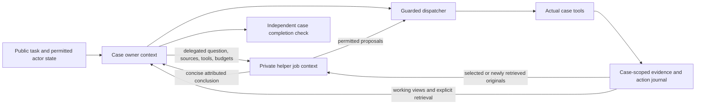

# Implementation: evidence-aware recovery and scoped helpers

Authorized October 24, 2026 after the stopped t033 -04 investigation. Root owns
coding; no delegated coding agents. Baseline: commit `8747896`,542 tests.

One-time same-chat continuation fired October24 at07:20 Asia/Kolkata,
automation ID `continue-healthcare-harness-implementation-once`. It was deleted
after firing so it cannot repeat. Root continued the implementation in this chat.

## Required scope / design

1. Explicit absent-path versus omitted/partial inspection results and navigation.
2. Source-backed prerequisite records: distinguish schema-required fields,
   source-linked clinical/policy claims and unverified hypotheses. Code checks
   provenance/schema facts; model retains clinical interpretation.
3. Concise case working record of findings/questions/completed investigations.
   Notes and helper conclusions remain interpretations, never new clinical facts.
4. Repeated identical observed outcomes trigger plan reconsideration within
   existing budgets. No task-specific answer or forced clinical action.
5. Distinguish observed existing identities from source-linked authored labels;
   preserve genuinely required public catalogs and patient isolation.
6. Expose composition in the actual batch CLI/config/frozen provenance; remove
   hardcoded combined mode. Owner can delegate tool-using bounded helper jobs
   with their own contexts. Tools and write authority explicitly delegated from
   existing owner permissions, with shared budgets/fences/source audit. Parent
   context receives a concise attributed result, not the entire helper transcript.
   Existing read-only analysis calls remain compatible; no nested delegation.

## Implementation

- `planning.py` records source-linked working notes and prerequisite claims.
  API input requirements, optional fields, retrieved policy passages, observed
  gaps and hypotheses have distinct status. Source/passages and schema facts
  are checked by code; necessity and clinical interpretation remain the model's
  responsibility. Even a source-backed claim is not marked clinically verified.
- `case.get_tool_contract` exposes the permitted schema and description;
  `case.record_blocker` records its basis, including nested schema locations;
  `case.record_working_note` upserts concise findings/questions/next steps.
  `case.get_working_record` pages older records and job summaries without copying
  helper transcripts. Notes do not create clinical evidence or grant authority.
- `missing_path_feedback` reports absence in the stored original observation,
  available fields and the empty-string root pointer. Inspection distinguishes
  present null/blank values, omitted previews and absent paths. Confirmed absence
  survives recent-history compaction with its source ID and historical scope.
- Progress tracking compares business-result content, rather than treating a
  new evidence ID or varied arguments as new information. Repeated external
  outcomes and local investigations are exposed in the working record. After
  three model calls without new observed information and repeated outcomes,
  the controller adds one replanning prompt per unchanged information state.
  This is an informational heuristic, not a termination rule, cache of live
  state, forced action or proof that no useful reasoning occurred. Existing
  model/tool budgets remain the limits. Legitimate fresh reads stay permitted.
- The prompt distinguishes existing patient/case/review/source identities from
  source-linked labels on newly authored records where the API permits them.
  Declared enum/catalog constraints and identity checks remain enforced. No
  catalog's absence is hardcoded into clinical behaviour.

## Actual helper execution

`helper_jobs.py` implements sequential, bounded tool-using workers. The owner
chooses the responsibility role, question, original evidence IDs, tool names,
optional write authority and job budgets. Default tool-using job budget is 4
model calls / 8 proposals; the owner can override these within the shared case
budgets. The controller reserves one model call for owner integration. A helper
request that cannot fit returns explicit budget feedback instead of consuming
that final call.

Without selected tools, existing read-only role analysis remains supported.
With tools, the helper can fetch new permitted evidence and optionally perform
the specifically delegated writes. Whole proposal groups are checked against
delegated permissions before dispatch. Patient identity, policy provenance,
transaction fencing, case guards and action journaling reuse the owner's actual
dispatcher. No recursive delegation or patient identity reset is delegated.
Unknown writes stop for reconciliation; interrupted jobs cannot restart silently.
Lease renewal spans both model waits and long retrieval/indexing operations.

Each job has its own conversation and completion scope. It does not receive the
owner's transcript or whole-case completion ledger. The parent receives a
bounded conclusion, original evidence IDs, open questions and execution counts.
Helper originals remain in the case audit store and can be explicitly retrieved;
their full messages/reference documents are excluded from the owner's automatic
context. General role summaries replace full role descriptions in helper modes;
full contracts remain available on demand.

`BatchConfig.composition` and `--composition` are frozen with source provenance
and passed to the actual actor invocation. The batch default is now `helpers`;
`combined` disables delegation, while `team` permits several jobs executed
sequentially. Direct standalone callers can explicitly select their composition.
Logs identify `HELPER_START`, `HELPER_END`, `REPLAN` and `model_role=helper`.

## Executed verification and evidence limits

- Initial inherited 542 tests passed after first integration. Expanded suites
  then passed 568, 570, 571 and 572 tests as regression coverage and corrections
  were added. Final full suite: **573 tests pass / 70.409 seconds**. Acceptance receipt:
  `HealthHarnessCodex/runs/20261024-recovery-helpers-complete-tests.log`.
- Tests exercise required versus optional catalog fields, policy-source
  provenance, blank/missing clinical fields, historical negative readouts,
  case-note retrieval, labelled interpretations, repeated identical results,
  source-reference churn and controller replanning without forced termination.
- Delegation tests cover independent retrieval, approved writes, denied tools,
  recursive delegation refusal, parent-context separation, shared budgets and
  failed-call usage, foreign-patient quarantine, durable attempted-action counts,
  owner/helper logging, live fence renewal during long tools and unknown-write/
  interrupted-job reconciliation. Batch tests invoke the actual runner callback
  and verify selected composition is both frozen and forwarded.
- Read-only replay against the stopped -04 snapshot produces explicit original-
  source absence for its queried field and correctly reports the cited version
  field optional. Receipt: `runs/20261024-recovery-retrospective-check.json`.
  No original actor action, fixture inspection or official grading occurred.
- Real Luna-high synthetic run 01 completed the owner task but exposed erroneous
  whole-case completion instructions inside a helper. The helper context was
  corrected and regression coverage added. Run 02 then completed both jobs.
  A post-completion context reconstruction for 02 did not match the recorded
  fingerprint; it is not used as proof of actual native context privacy.
- Real Luna-high run 03 instruments the actual model input for long-document
  visibility. Owner and helper completed in 4 calls (2 each), 2 proposals,
  one in-memory tool execution, 46444 reported tokens. The long source was
  visible to the helper's post-read call and absent from BOTH owner calls.
  Accepted synthetic completion predicate; no dataset actor or paid judge.
  Receipt: `runs/20261024-delegated-helper-native-03/receipt.json`, with adjacent
  private result/state/events and the reproducible ignored script.

These are implementation and synthetic protocol results, not benchmark success,
clinical-policy accuracy, dataset reliability or measured cost savings. Semantic
interpretation and helper selection can still be wrong. The progress detector
does not prove semantic novelty; it flags exact unchanged business content. No
hardcoded task answer or hidden expectation was used. Existing stopped -03/-04
artifacts are preserved. Temporary zero working-context cap and separate 2 MiB
provider guard remain unchanged.

## Next user-run check

Fresh explicit UM t033 only, directory `runs/20261024-random-um-t033-05`,
`--composition helpers`, concurrency 1, attempts 1, model budget 100, tools 500,
context 0, timeout 180, Codex simulator 8. Plan-only must confirm one task before
the full command is delivered. No actor/judge rerun was launched for this work.
