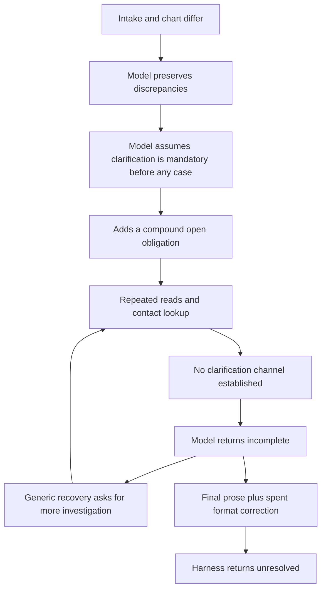

# Why t021-06 stopped, and whether it should have

## Conclusion

The attempt stopped before creating a provider PA case. This was not a finished
workflow, a verified valid clinical handoff, or an exhausted execution budget.
The model chose to stop because it considered service intent and a narrative/
imaging discrepancy unresolved. The harness ultimately returned `unresolved`
through its final-response formatting path, rather than a validated decision
that the remaining work could not proceed.

Recognizing conflicting evidence and refusing to fabricate facts were correct.
The necessity of stopping *all* work before case creation was not established.
No observed policy clause or tool error made clinician clarification a required
precondition to that action. The strongest supported diagnosis is a model-created
dependency that was not sufficiently challenged, combined with a termination
path whose immediate reason was output format instead of substantive blockage.

This is a diagnosis from public instructions, actor-observed records, the saved
conversation and harness code. No hidden expected answers, simulator source,
fixtures or official judge were used. The correct final clinical/policy outcome
is still unverified.

## The substantive reason given by the worker

The intake describes a clinical presentation and recommends further evaluation
for definitive management. The actor-visible chart contains a more specific
planned surgical procedure and its code. Separately, the intake and MRI differ
on whether a second tendon has a full- or partial-thickness tear.

Those are two distinct questions:

| Question | What is established | What remains a judgment |
|---|---|---|
| What service is documented? | The chart explicitly documents a planned procedure and code. | Does the public intake forbid acting on that documented plan? No explicit prohibition was found. |
| How should conflicting clinical descriptions be represented? | The two sources disagree on tear extent. | Does that particular discrepancy block selecting the documented service, only affect downstream criteria, or require clarification? |
| Has the surgeon's requested setting met policy? | A request/plan is source evidence of what is requested. | Policy eligibility is a separate later decision; a documented plan does not prove it. |
| Must a clinician be contacted before a draft exists? | The model wanted this; the contact lookup was empty. | No cited governing rule was found requiring this particular prerequisite. |

The wording difference between a broad intake and a specific chart plan may be
a difference in clinical stage rather than mutually exclusive orders. That is
an inference, not proven chronology: the intake's creation time was not
established. The tendon discrepancy is real, but its relevance must be assessed
for each proposed action rather than treated as automatically blocking every
action. Preserving both source attributions is different from claiming they
agree or rewriting either source.

## The role and tool surfaces did not require an existing order

Follow-up confirmation requested by the user: the live public `tools/list`
contract was inspected from the same pinned runtime version, without calling
case creation. It explicitly supports creation of a new request and a draft
case; adopting an existing order is optional. Its required inputs are patient,
ordering provider, service category, procedure code/description, urgency,
diagnoses and site. No clarification receipt, prior clinician confirmation,
or condition that every source narrative agree is declared. Public task and
observed role/workflow guidance likewise did not establish that requirement.
The worker's own obligation supplied the pre-case clarification dependency.
Private contract receipt: `runs/20261023-t021-06-analysis/create-contract.private.json`.
This confirms the dependency is unsupported by the inspected authoritative
surfaces; it does not prove that every hypothetical input would pass runtime
validation or that a particular final disposition would pass the judge.
It also does not establish whether the assumption originated in pretraining,
our caution instructions or inference during this run.

The role guide the worker read describes a workflow intentionally starting
without a PA case or service request, with downstream provider records to be
constructed using the vignette, chart, written references and exposed tools.
The observed case-creation capability marked the existing source order optional.

The worker eventually acknowledged this. Its later replies explicitly said the
successful empty candidate-order result was not itself a blocker. The stopping
reason had shifted to its interpretation of service intent and source conflict.

The case-creation tool was present in the supplied tool list on **14 of the15
workflow turns**. The one exception was the deliberately tool-free formatting
correction. No case-creation proposal was made; consequently no runtime schema,
patient-isolation check, policy-provenance gate or actor rejection blocked such
a proposal in this attempt. This does not prove a hypothetical creation call
would succeed: its actual required values would still need source-backed
justification. For example, this analysis has not independently justified every
priority/category value in a complete creation request.

The public provider tool reference also lists a provider information-gathering
disposition among the supported outcomes. Its existence does not establish that
it is correct here, or that it is available before required case/form setup.
It does establish that unsubmitted private notes are not the only conceptual
way to represent genuinely missing evidence. No unsupported disposition should
be forced just to produce a packet.

## Where the worker introduced the stopping dependency

At workflow call4, the worker added obligation
`resolve_service_and_source_discrepancies`. It grouped together:

- Establish the intended service before case creation.
- Preserve the tendon-description conflict.
- Identify the ordering practitioner.

The provider identity was subsequently established, and a documented procedure
was repeatedly acknowledged, but the obligation was never narrowed. Preserving
a discrepancy became entangled with resolving it, and resolving it became a
prerequisite to all case creation. No source was attached establishing the
necessity of that prerequisite; `case.add_obligation` initializes evidence IDs
empty and checks dependency consistency, not the semantic necessity of each
model-authored obligation.

This was a cognitive/planning restriction, not a case-creation lock enforced by
the ledger. Open obligations matter when accepting completion, but they do not
by themselves prohibit unrelated external actions. The model's repeated promise
not to create a case was what prevented progress here.

The questionable edge is B→C. Recognizing a conflict does not, by itself, prove
that every administrative step requires its resolution. That implication must
be justified by the action's real factual and authority requirements.

## Exact stopping sequence

Workflow numbers below exclude the12 identity/setup calls.

| Workflow call | What happened | Effect |
|---:|---|---|
|1–3|Chart/orders/provider reads and initial source/handbook retrieval|Established source material; no case creation.|
|4–7|Added the compound obligation; searched references; identified the clinician; checked contacts; read more chart context|Continued evidence collection but kept the same pre-case clarification assumption.|
|8|Returned a structured non-complete answer|Harness issued recovery1.|
|9–11|Re-read sources and provider workflow guidance|Acknowledged new-request creation was allowed but kept treating service intent as unresolved.|
|12|Returned prose declaring work unresolved|Harness used its one final-format correction.|
|13|Returned structured incomplete JSON|Harness issued recovery2.|
|14|Repeated the stated blocker and retrieved more existing chart context|No case creation or new disposition.|
|15|Returned prose again|No final-format correction remained; harness returned unresolved.|

The final result message was a format message: the model returned prose without
the required structured completion record. The underlying content still stated
the service/clinical discrepancy blocker. Those are different layers and should
not be conflated.

## Why the harness accepted the intermediate stop

In `engine.py`, stop recovery is attempted for an unresolved **dictionary**
final—such as structured incomplete JSON. A prose final is stored as a string,
so that recovery branch does not run. A separate format-only correction is
available once. It was used at call12. At call15, prose plus the spent format
allowance led directly to returning the unresolved result.

Only two of the configured four stop recoveries had been used. There was no
call-limit reason to exit:27 aggregate model calls of100 and23 counted workflow
tool proposals of500. There was no provider error or context-limit exhaustion
recorded. `workflow_stop_reason` was null, which obscured the substantive reason
the attempt ended.

Unused budget is not itself a fault: a completed task or genuinely unresolvable
blocker should stop early. The issue is whether that stop is justified and
reported accurately, not whether all100 calls were consumed. The settled
one-attempt batch does not automatically send the model back to this case.

However, **fixing only the prose branch would not resolve the planning stall**.
The current evidence fingerprint equals the fingerprint captured for recovery2.
A structured final at that point would have reached the recovery function and
been stopped as `no_new_source_evidence_after_recovery` instead. Local
`case.retrieve_evidence` can expose new views without creating an original
evidence item; the recovery fingerprint specially tracks inspection views but
does not generally represent every such awareness change. The last retrieval
may also have been substantively repetitive. This analysis does not assert it
revealed useful new information.

## Was stopping exactly what was supposed to happen?

There are three separate answers:

1. **Did the code follow its current branches? Yes.** The final prose response,
   the exhausted one-time format correction and the dictionary-only recovery
   branch explain the returned `unresolved` state.
2. **Was the healthcare task completed? No.** No provider case, forms,
   disposition or submitted packet was created. A saved evaluation snapshot is
   not task completion.
3. **Was this a justified blocked-workflow endpoint? Not demonstrated.** A
   justified stop would identify the next otherwise-valid action, the exact
   missing prerequisite for it, the source requiring that prerequisite, why the
   existing chart does not satisfy it and why other permitted useful actions
   cannot proceed. The worker named uncertainties and an unavailable contact
   path, but never established that clinician clarification was mandatory
   before draft creation. No official judge confirms that stopping was correct.

The current best interpretation is premature abandonment caused by unresolved
task interpretation. It is not evidence that the task is defective, that the
chart is unusable, or that safety requires forcing submission. A documented
plan can support a request record without proving coverage eligibility; those
questions must remain distinct.

## Correction priorities suggested by the evidence

These are proposals only; no behavior code was changed for this analysis.

- Require the model to explain *action-specific* blockage: which field/action,
  which missing fact, which governing source, and what alternative work remains.
  Code can check source existence/scope; the model interprets clinical relevance.
- Keep discrepancy tracking separate from mandatory prerequisites. A source
  disagreement must not silently become a requirement to contact a clinician.
- Review compound obligations when some components are already satisfied.
  They should not persist unchanged solely because they were written early.
- Preserve a substantive stop reason even when the final response is malformed.
  Formatting and workflow progress are separate concerns.
- Evaluate progress by changed understanding/action options, not simply another
  file read or repeated statement. More retries without a new reasoning strategy
  would extend the same loop.
- Test both directions: a documented plan plus nonblocking source discrepancies
  should not force unnecessary paralysis; genuinely contradictory required
  service information or unsupported identifiers must still prevent guessing.

Do not fix this by hardcoding the requested procedure, blindly preferring every
chart note, increasing budgets, ignoring imaging conflicts, forcing a clinical
disposition or treating a finished snapshot as a benchmark pass.

## Cost and evidence appendix

| Scope | Model calls | Reported input | Output | Total tokens |
|---|---:|---:|---:|---:|
|Identity/bootstrap|12|158784|5484|164268|
|Workflow|15|648924|11054|659978|
|Entire observed attempt|27|807708|16538|824246|

The earlier update called659978 the run's reported usage; that was the workflow
only. `evaluation.json.metrics.reported_usage_this_segment` gives the824246
aggregate, while `reported_usage` gives the workflow counters. Cached input is
a subset of reported input, not additional tokens. These fields need clearer
labels when presenting totals.

Summed model latency296.221s; summed hybrid-search latency42.563s; batch elapsed
approximately399.031s. These are recorded durations, not a controlled performance
comparison. The workflow's context payload reached95518 characters, with no
context-limit error. Retrieval/caching worked, including37429 broad-corpus and
21199 policy-vector disk hits, but it supplied more evidence without changing
the model's stopping premise. None of the four query-cache lookups was an exact
repeat hit. The major remaining inefficiency in this run was repeated model
reasoning around the same dependency, not rebuilding the whole handbook.

Evidence used:

- Public `instruction.md` for the selected task only.
- Run -06 `state.sqlite` opened read-only, `result.private.json`,
  `run.result.json`, `events.jsonl`, `evaluation.json`, manifest and identity audit.
- Handbook excerpts already observed by the worker, referenced by original
  evidence IDs rather than copied into this tracked document.
- Explicitly permitted `/opt/healthverse-task-assets/tool_reference.md`, read
  from the same pinned runtime version without actor mutations. Private read
  receipt and compact measurements:
  `HealthHarnessCodex/runs/20261023-t021-06-analysis/`.
- `engine.py` final acceptance/recovery branches; `workflow.py` recovery limit,
  prompt and fingerprint; `roles.py` and standalone identity-handoff instructions.

No patient identifiers or raw handbook content are reproduced here. No new
dataset run, model inference, paid judge or code fix was performed for this
analysis. The correct benchmark disposition and official strict score remain
unmeasured.
